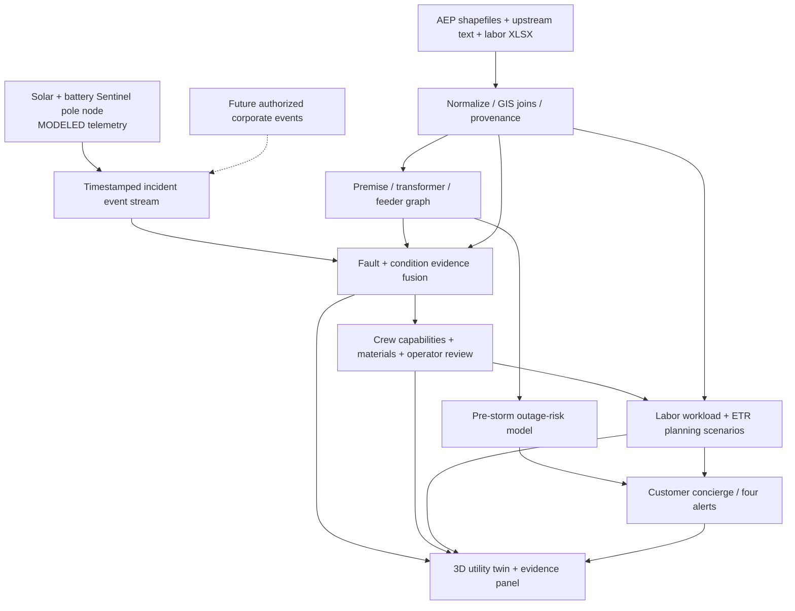

# LoadShed Sentinel — FINAL IMPLEMENTATION BLUEPRINT

**HackOHI/O 2026 × AEP AI Outage Concierge**  
**Build goal:** one complete, 3D, cloud-architected, data-backed web application in the remaining hackathon window.  
**Team:** four human teammates working concurrently; up to five AI coding agents/subscriptions can assist.  
**Scope lock:** preserve the original transformer-monitoring + solar/battery node + evidence-based fault detection + qualified crew recommendation + restoration modeling + personalized customer-concierge experience. **Do not pivot to a generic chatbot.**

> **Read first — rubric-aligned update (Oct 24, 2026):** Keep the existing two-sided LoadShed Sentinel concept and original four-person ownership. The official AEP sponsor brief makes *customers* the primary audience; the pole/sensor and crew-triage systems are the engineering differentiator, but must **feed a complete customer journey**: customer selects an anonymized location → outage risk/confidence → changing restoration range → preparation → alert eligibility and four messages. In addition, prove the six published **HackOHI/O judging criteria** through a working demo, documented tests, and judge-visible evidence (see rubric crosswalk below). Do not pivot to a generic chatbot or add unvalidated ML merely for a rubric label.

## 0. EXECUTIVE BUILD ORDERS (PIN THIS IN TEAM CHAT)

### Exactly what you're building

**LoadShed Sentinel** is a two-sided application. Its **3D utility control room** features a realistic pole-mounted transformer, protective cutout, solar/battery sensor pod, animated telemetry, feeder/GIS map, probabilistic incident triage, suggested qualified crew/equipment package, and explainable repair/ETR estimate. The **customer concierge** maps each anonymized home to its supply path where data permits, forecasts storm outage risk, explains relevant restoration scenarios, guides preparation, and manages four proactive alerts.

**The 3D scene must not be a disconnected animation:** pressing a scenario button must change the *same backend incident* across sensor overlays, maps, fault hypotheses, crew recommendation, repair estimate, household status, and notifications.

### The four people

| Human owner | Independent module | Owned code | End-of-shift proof |
|---|---|---|---|
| **Teammate 1 — DATA & GRAPH** | Ingest supplied AEP files; normalize shapefiles; match transformers/premises/circuits; pre-storm risk features; trace upstream equipment; export map GeoJSON | `pipeline/`, `engine/risk.py`, `engine/topology.py`, `data/processed/` | Actual imported feature counts, join-quality report, working `GET /api/network` and risk JSON |
| **Teammate 2 — FAULT, CREWS & RESTORATION** | Evidence-fusion classifier; *qualified crew capability* suggestion; labor workbook parser; interval ETR/scenario engine; simulated sensor/solar energy calculator | `engine/diagnosis.py`, `engine/crew.py`, `engine/restoration.py`, `engine/energy.py` | Four scenarios correctly change diagnosis, crew equipment, and repair range; no unsupported certainty |
| **Teammate 3 — 3D & UTILITY UI** | Visually excellent React/Three.js pole twin, animated cutout, weather, surface-temp glow, solar/battery HUD; 2D GIS map; operator panels | `web/src/three/`, `web/src/pages/UtilityPage.tsx`, reusable charts | 3D pole visibly reacts to incident updates from agreed API fixtures |
| **Teammate 4 — CUSTOMER, API & INTEGRATION LEAD** | FastAPI app/contracts, demo scenario orchestration, customer concierge, notification engine, privacy rules, smoke tests, final video/submission | `api/`, `engine/customer.py`, `web/src/pages/CustomerPage.tsx`, `tests/e2e/`, `demo/` | One URL running both utility and customer views with scenario controls and alert history |

**Optional AI agent #5 = QA / integration reviewer**, not a fifth product owner. It tests branches, flags mismatches, verifies source labels and helps prepare the 3-minute video. Assign one **human** to final integration/merges (Teammate 4). Only one person edits common API schema files after freeze.

### Build order / priority

1. **P0 sponsor requirements:** real repository data ingestion, customer location/risk, restoration range, guidance, alerts, privacy/uncertainty.
2. **P0 differentiator:** explainable fault/crew triage connected to a functional 3D pole twin.
3. **P1 differentiation:** solar/battery endurance model and 3D animated telemetry; historical damage analytics.
4. **P2 if time:** external DER-Fault/transformer laboratory dataset ML, sophisticated LLM voice, photorealistic assets, production cloud deployment. **Do not make P2 a dependency of P0.**

**Rubric-driven gate:** A judge must see **one actual or faithfully sourced AEP grid path**, one incident whose change propagates through both views, **one crew/labor/step-restoration calculation**, and a customer-facing risk/preparation/alert sequence. That coherent vertical slice wins precedence over adding another dashboard, sensor effect, or machine-learning model. Rubric criteria do not have published numerical weights on the event landing page: do not invent a weighting scheme.

### Non-negotiable claims

- The official AEP package provides damage/GIS/topology/labor data; it **does not thereby guarantee labeled pole-sensor failure histories**. Sensor telemetry for the node is modeled unless separately verified.
- “Probabilistic fault type” means a calibrated predictive probability **only if trained/tested on suitable labels**. Until then show **rule-based evidence scores / relative likelihood**, with source labeling and an `unknown` outcome. Don't relabel made-up percentages as trained ML probabilities.
- “Recommend crew type” means **operator-reviewed capabilities/equipment**, not naming or automatically dispatching a specific employee.
- “Repair-time estimate” is a **planning interval under assumptions**, never a guaranteed AEP ETR.
- The claim “we save 8–10 hours” is **unmeasured**. Demo the potential missed-dispatch avoidance workflow and break-even sensitivity, not a factual savings figure.

---

## 1. Source of truth: original vision versus confirmed AEP requirements

### Preserved original product features

- **Physical concept:** pole-mounted gray cylindrical distribution transformer; porcelain insulators; protective cutout/fuse; lines; tiny controller + temperature/load/vibration/acoustic sensing; **25-W-class solar concept, cold-aware 41-Wh battery model, LTE-M event communications**, buffer/retry on grid outage.
- **3D digital twin:** orbitable zoomable realistic pole, cutout animation, visual heat/anomaly states, floating sensor HUD, storm lightning/rain, asset event timeline, highlighted downstream homes, solar/battery reserve state.
- **Fault brain:** abnormal event detection; categories for protective-device operation, severe equipment condition, upstream feeder fault and unresolved/conflicting evidence; show evidence for/against and confidence type.
- **Repair coordination:** infer likely repair categories; map to qualified crew capabilities and likely materials using AEP damage/labor/structure information; operator review; compute restoration scenarios and explain changes.
- **Customer concierge:** location-to-grid supply visualization, why one home has power and neighbor doesn't (only when topology supports it), four states of alerts, food/preparation/medical needs with safety limits, backup battery planner, and optional customer reports.

**Original-upload limitation:** The two uploaded Markdown files were identified, but reopening their full bytes failed during this document generation. This preserves the specific design details already established in our conversation. Cross-check any pixel-exact layout, wording, or additional asset specifications against the original uploads before freezing visual polish. This does *not* affect the independently verified official challenge requirements below.

### AEP's five confirmed requirements (all are mandatory)

| Requirement | Implemented by | Judge sees |
|---|---|---|
| **1. Outage risk** for anonymized premise/circuit/location; contributors and uncertainty | Data/graph risk engine + customer page | Risk band, explanation, risk-factor breakdown, missingness |
| **2. Restoration range** based on damage/quantity/dependencies/labor/travel/step restoration; changes with inputs | Repair scenario calculator | Min/base/max range and scenario slider updates; official ETR separate |
| **3. Preparation and safety** adapted to declared needs | Customer decision rules | Household-specific checklist, emergency caveats, no promises about food/medicine |
| **4. Alerts** eligibility, timing/channel/escalation, four message types | Customer state machine | Pre-storm, outage-confirmed, estimate-updated, restoration-complete messages |
| **5. Explainability/privacy/fallback** | All modules | Observed vs inferred vs simulated, unknown handling, no raw PII or sensitive-grid internals |

**Source:** [Official challenge repo](https://github.com/hackohio/aep_challenge_hack26), [`docs/HackOHIO_2026_AI_Outage_Concierge_Challenge.docx`](https://github.com/hackohio/aep_challenge_hack26/blob/main/docs/HackOHIO_2026_AI_Outage_Concierge_Challenge.docx) and organizer-supplied 5-page challenge brief available in the shared browser. It explicitly accepts **known or simulated damage and operational conditions**, and asks for a focused, credible prototype — not a production outage-management system.

### OFFICIAL HackOHI/O 2026 judging rubric — evidence to demonstrate, not a new feature list

**Source:** [HackOHI/O 2026 public judging criteria](https://hackohio2026.devpost.com/) (six named criteria) and [official rules](https://hackohio2026.devpost.com/rules). These are the **general-event judging criteria**; the **five AEP sponsor requirements above** are a separate, complementary completeness check. The public landing page names criteria but does **not publish numerical weights**. Do not claim a scoring percentage or sponsor-specific weighting unless judges supply it separately.

| Official criterion | How the ORIGINAL LoadShed Sentinel plan satisfies it | Show the judge (observable proof) | Main owner |
|---|---|---|---|
| **Innovation** | One incident drives a solar-resilient pole-sensing **concept**, 3D digital twin, graph-aware fault triage, crew-capability recommendation **and** proactive customer guidance; differentiation is the *integrated decision chain*, not a claim that sensors or chatbots are new. | Toggle the same modeled pole incident once; both operator and customer views respond and the explanation shows the logic behind the change. Contrast briefly against a static outage-status page, without claiming competitor performance. | 2 + 3 + 4 |
| **Curiosity** | Tests competing electrical explanations: local cutout vs upstream feeder issue vs confirmed equipment damage. GIS, topology and labor assumptions are examined instead of invented. | Show one tested hypothesis and a negative/control case (upstream interruption **does not** trigger local transformer replacement). Preserve source-field discoveries or mentor feedback in a log. | 1 + 2 |
| **Communication** | Animated 3D pole is paired with a geographically grounded 2D map and a plain-language customer concierge; estimates are ranges, not technical jargon or false precision. | Complete one end-to-end narrated journey in <=3 minutes. Put **Observed AEP / Modeled Sensor / Simulated Scenario / Confirmed Utility (if any)** source labels on screen. | 3 + 4 |
| **Project Breadth and Complexity** | Geospatial ETL, premise-to-substation graph, dependency tracing, electrical failure reasoning, construction-unit/person-hour math, scenario engine, 3D rendering, responsive UI, privacy and notification logic. | Trace **ARCOS damage → matched asset → upstream/downstream customers → labor unit → prioritized repair → customer message**; show actual data counts and join coverage. | 1 + 2 + 3 + 4 |
| **Impact** | Potential to improve triage and reduce avoidable misdispatch while giving customers actionable restoration context; safety and critical-location handling matter. | Show grounded **customers potentially affected** and *modeled* before/after crew or sectionalization scenarios. Quantify only scenario assumptions; **no measured savings or accuracy claim** without validation. | 1 + 2 + 4 |
| **Growth Mindset** | Explicit unknown/fallback mode, error tests, assumption revisions, versioned scenario cases and source audit trail. | Present **one real problem encountered during the hackathon**, how the team tested it, and what changed. Never invent a mentor quote, pivot, failed experiment or successful metric. | All; 4 records |

**Rule of presentation:** Do **not** create six disconnected panels named after the rubric. Each criterion must be supported by the **same original product** plus an observable test, source, or explanation. A working, traceable scenario is more valuable than aesthetic screens that are disconnected.

**Prior-work disclosure is mandatory:** The [official 2026 rules](https://hackohio2026.devpost.com/rules) state that judges evaluate work completed **during the hackathon** and require disclosure of any prior development. In `README.md`, separate the original concept/prior assets from code, data processing, implementation and testing completed on Oct 24–25. Do not imply earlier concept work was built during the event.

### AEP data-guide and judge-facing engineering crosswalk

The team's photographed **AEP AI Outage Concierge Data Guide** adds important restoration detail beyond the customer-oriented sponsor brief. To prove engineering depth without changing the product concept, trace these four questions through **one chosen incident**:

| AEP's key question | Required trace in app / engineer notes | Evidence gate |
|---|---|---|
| **1. What is damaged?** | Inspect ARCOS damage fields; use direct pole location match where valid, otherwise nearest-pole spatial match with distance and `inferred_match` labeling. | Show original and mapped asset IDs, source coordinate reference system and unmatched rate; distinguish reported damage from generated sensor telemetry. |
| **2. Which customers depend on it?** | Combine premise/secondary/transformer/primary layers with `matched_upstream.txt` sequence; calculate the affected downstream set and recognize upstream protective devices. | One **traceable premise → transformer → primary → fuse/switch/recloser → substation** path or clearly flagged partial path. Never assign a customer by nearest pole silently. |
| **3. What repair/isolation work is needed?** | For confirmed broken pole, map pole height/class, primary phases, `structure_drawings.pdf` and labor workbook to potential construction units. Evaluate isolation at switches/reclosers/fuses when topology suggests a path. | Show one materials/crew-capability assumption, its source and an explicit **step-restoration vs full-repair** comparison. Switching is advisory, not live operational instruction. |
| **4. With limited crews/criticality, what first and how long?** | Rank restoration opportunities by customers potentially re-energized, critical facilities in privacy-safe aggregate, work effort and dependency/access conditions; report ranges under 2–8 person crews / scenario constraints. | For at least one plan show affected customers, a criticality reason, total person-hours, crew assumption, and **fast/expected/difficult** ETA range; offer a scenario change. |

**Printed-guide labor assumption (important correction to the earlier caution):** The supplied AEP **Data Guide explicitly instructs a 4.5 indirect-labor multiplier** for direct job-site hours to account for travel, setup and safety discussions; its example is `6 direct hours × 4.5 = 27 person-hours`. This is **given challenge guidance**, not an arbitrary factor. Still inspect the workbook to identify **what each labor cell measures** and avoid applying 4.5 a second time to totals that already include indirect effort. Do not separately add the same travel/setup categories after applying the multiplier. Person-hours are **not** wall-clock hours; crew size, simultaneity, access, travel already included, step restoration and sequencing affect duration. Disclose the assumption on the screen.

**AEP sponsor brief minimum journey (all mandatory):** choose anonymized location → risk + confidence + factors → editable restoration range → personalized safety preparation and alert eligibility → proactive message(s) → explicit privacy, limitations and missing-data fallback. It accepts simulated operational conditions; clearly distinguish source data from generated inputs.

**AEP conversations:** The team spoke with AEP representatives, but their exact feedback is not documented here. Record the *actual* technical feedback, date and resulting change in `docs/judge_evidence.md`; do not imply sponsor endorsement or that a feature was explicitly approved without a recorded statement.

### Rubric proof artifacts — minimal, practical

- `docs/judge_evidence.md` (new, short): **criterion → screen/CLI command → proof/filename → status → person responsible**; include a real test failure/revision and a factual log of mentor feedback if applicable.
- `docs/data_inventory.md` + `docs/source_ledger.md` (already in plan): original AEP field names, CRS, join rate and exactly which displayed quantities are **Observed AEP / Derived / Modeled / Simulated**.
- `tests/e2e/` + screenshot/video: assert that a single incident change updates **3D, network, risk/status, crew, ETR, customer copy and alert history** from one shared `ScenarioSnapshot`.
- README's 90-second technical notes: network join caveats, risk scoring rationale, 4.5 labor handling, crew/operator safety, step-restoration uncertainty, worked example, prior-work disclosure.

**Completion rule:** A planned capability is not 'rubric complete' until it works and there is reproducible evidence. Unimplemented items should be visibly marked **Planned** rather than checked off.

### Actual repository inventory (confirmed; inspect files locally to establish columns)

Repository: `https://github.com/hackohio/aep_challenge_hack26`  
Inventory: [`data/README.md`](https://raw.githubusercontent.com/hackohio/aep_challenge_hack26/main/data/README.md)

| Asset in repository | Officially described content | What it enables | Doesn't prove |
|---|---|---|---|
| `data/raw/Data1.zip` (**18.3 MiB**) | GIS customers, poles, primary lines, fuse banks, damage assessments, ambulance, fire, hospital features | Pre-storm risk, spatial damage patterns, community-impact view, cutout/protection context | Transformer internals or true fault-diagnosis sensor labels |
| `data/raw/Data2.zip` (**12.1 MiB**) | GIS secondary lines, transformers, switches, reclosers | Network geometry, map visualization, equipment relationships | Automatically correct every premise-to-transformer join |
| `data/raw/matched_upstream.zip` (**1.4 MiB**) | `matched_upstream.txt` associations | Premise/upline dependencies, impact footprint and step-restoration graph | Actual live switching state unless included separately |
| `data/Install_Labor_HackOHIO.xlsx` | Installation/labor references | Repair-work calculations (once units checked) | Dispatch delays or verified restoration wall time |
| `docs/structure_drawings.pdf` | Distribution structure examples | Material/package explanations and 3D visual reference | Certified bill of materials for a specific incident |
| `docs/HackOHIO_2026_AI_Outage_Concierge_Challenge.docx` | Challenge requirements + data descriptions | Acceptance criteria | All proposed fields present in actual data extracts |

**Important:** The challenge brief lists ARCOS damage records, STORMS labor, and indirect-labor assumptions as possible data. The separately supplied printed Data Guide specifically provides a **4.5× direct-to-total person-hour multiplier**; inspect the actual workbook/shapefiles before deciding which labor rows and columns need that factor, and do not double-count embedded indirect time. We have verified the archive inventory, not all extracted schemas or records.

### Get the files, immediately

```bash
git clone https://github.com/hackohio/aep_challenge_hack26.git reference-aep
mkdir -p reference-aep/data/extracted/{Data1,Data2,matched_upstream}
unzip -n reference-aep/data/raw/Data1.zip -d reference-aep/data/extracted/Data1
unzip -n reference-aep/data/raw/Data2.zip -d reference-aep/data/extracted/Data2
unzip -n reference-aep/data/raw/matched_upstream.zip -d reference-aep/data/extracted/matched_upstream
find reference-aep/data/extracted -type f | sort | head -100
```

Keep `.shp/.shx/.dbf/.prj` together. Source files stay read-only outside your app's tracked data; keep derived sanitized fixtures in `data/processed/` and do not commit unreviewed sensitive datasets. **First 60–90-minute gate:** export a data dictionary/row counts and 1 real graph path; if an essential column does not exist, code a documented fallback.

---

## 2. Product flow and architecture

### Pre-storm journey — mandated by the sponsor

Customer chooses an anonymized premise/circuit → topology and proximity features from AEP GIS/upstream records → historical damage/risk scoring and storm scenario → **Low/Moderate/High risk** + quality/confidence tag → personalized preparation actions → pre-storm alert eligibility.

### During/after an outage — core original differentiator

Operator initiates a scenario event or receives a future approved sensor/grid feed → data normalization (observations + source + timestamps) → asset/outage localization → condition/fault evidence scoring → probable damage classes → suggested **crew capability package** → labor/restoration interval and step-restoration model → customer receives outage/estimate/restored updates. Same case simultaneously animates transformer and map.

### Data layer modes, explicitly separated

| Mode | Data type | Use in demo |
|---|---|---|
| `aep_challenge` | Actual organizer-provided GIS, topology, damage, labor | Feeder/premise relationships, damage patterns, workload baseline |
| `external_research` | Optional published measured or physics-simulated fault datasets | An evaluated narrow fault-class ML experiment if time allows |
| `modeled_sensor` | Generated pole temperature, acoustic anomalies, cutout state, battery | Operable digital twin with testable engineering assumptions |
| `scenario` | Storm, crew availability, access/traffic, confirmed field findings (explicitly controlled) | Restoration and communication walkthrough |
| `authorized_enterprise` | **Future only** OMS/AMI/ADMS/SCADA + installed field nodes | Interface documented; no current live-data claim |

### Architecture diagram



### Chosen technologies — minimize needless integration

| Layer | Choice | Reason |
|---|---|---|
| Frontend | **Vite + React + TypeScript + Tailwind** | Fast iteration and simple deployment |
| 3D | **three / @react-three/fiber / @react-three/drei** | Orbit controls, procedural pole/transformer, declarative animations |
| App state | **Zustand** | Central incident state shared by 3D/utility/customer displays |
| Map | **React Leaflet + GeoJSON** or MapLibre; choose one within first hour | Actual GIS layers and premise clusters |
| Charts | **Recharts** | Simple sensor, risk and ETR timeline plots |
| Backend | **FastAPI + Pydantic v2** | Typed contracts and Python geospatial/model ecosystem |
| Ingestion | **GeoPandas, pandas, openpyxl, pyogrio, pyproj** | Shapefiles/XLSX, shape validation, CRS normalization |
| Topology | **NetworkX** | Upstream traversal, impact and step restoration graph |
| ML optional | **scikit-learn** | Fast baseline; no need for GPU/LLM for operational numbers |
| AI wording | templates by default; optional LLM constrained to validated JSON | Offline-safe, no invented causes |
| Persistence | local JSON/parquet plus in-memory state; SQLite optional | Low overhead; demo should work offline |

**No live AWS deployment needed to prove the cloud architecture:** FastAPI mimics the centralized ingestion/inference service; diagrams show future MQTT/IoT Core ingestion and OMS connectors. Only deploy to a cloud host if the app is already integrated and video-ready. Browser demo may run locally.

---

## 3. DATA & GRAPH MODULE (Teammate 1)

### Required first outputs

1. `docs/data_inventory.md` listing archive paths, GIS layer geometry/CRS/columns/row counts/null rates/unique keys, workbook sheets + unit definitions, topology text format and unsupported fields.
2. `data/processed/asset_nodes.json` — sanitized asset IDs, types, feeder IDs, optional rated capacity, geometry in local-normalized or geographic coords, with confidence on every relationship.
3. `data/processed/network.geojson` — limited map example of real organizer geometry, no unreviewed premise-level personal fields.
4. `data/processed/damage_features.parquet` — actual available incidence/asset/proximity features with provenance; no invented labels.
5. `data/processed/graph_summary.json` — verified count of customers/transformers/links/unmatched premises and a demonstration transformer path.

### Parser and data quality

- Use `gpd.read_file`; inspect `crs` *before* projecting; geometry repair only if necessary; log each changed feature.
- Discover actual source keys. Do **not** join on row order or rounded coordinates if stable IDs are available. Build accepted matches + rejected/ambiguous matches, never silently force every premise to a transformer.
- Respect directed **upstream** topology, explicit switches/protective devices, and whether a relationship is inferred vs provided. If graph edges are only relational, do not infer electrical distances or energized states.
- For public map, generalized/obfuscated IDs and shapes; keep operator-only technical fields on server.
- Create deterministic fallback `DEMO-CIRCUIT-A` with 1 feeder, 3 transformers, 12 illustrative anonymous homes only if real organizer topology is insufficient or unsafe to expose; mark the fallback `modeled_topology`.
- If full GIS is huge, generate a small **real example subnet** selected by a valid upstream path; preserve source attribution and filters.

### Pre-storm outage-risk algorithm

**Baseline guaranteed to work:** explainable, ordinal risk-score engine built from AVAILABLE verified features. Examples *if present*: historical damage density per circuit/area, asset type, protective device upstream, neighboring damage, vulnerability near selected location, storm intensity user-slider, missing-data penalty. Use scenario assumptions only for meteorology not provided. Risk bands are **not calibrated probabilities** unless you can establish proper incident labels and temporal validation.

If historical ARCOS outcomes and sufficient pre-storm features exist, implement a trained supervised benchmark *after* leakage audit: grouped/time-split evaluation, label horizon, positive-class definition, precision/recall and calibration. Do not use recorded post-storm repair/damage severity to predict pre-storm outage if it would not have existed in advance.

**Return:** `{band, score_kind, source, drivers[], assumptions[], missing_inputs[], model_version, evidence_refs[]}`. A fixed “100% probability” is never shown. When no verified connectivity/risk data, show `UNCERTAIN` and preparation fallback.

### Feature acceptance tests

- A premise's upstream path is repeatable and explains its selected protective-device/circuit relationship.
- A deliberate unmapped premise does **not** fabricate an asset link.
- Risk score changes when storm scenario changes; missing damage data lowers confidence.
- Damage records belonging to a given spatial/asset context only influence valid target cases; no post-event data leakage.
- GIS export does not contain raw personal names, phone numbers or sensitive exact-location attributes.

---

## 4. FAULT, CREW, REPAIR & ENERGY ENGINE (Teammate 2)

### The correct probabilistic system

Separate **three predictions**:

1. **Grid incident category:** probable local protection operation vs upstream feeder outage vs damage indication vs unresolved, using grid/incident observations. Can be **rule-scored initially**; optionally train a narrowly defined classifier on appropriately labeled research grid-fault measurements.
2. **Transformer condition:** surface-temperature load-adjusted trend, vibration/acoustic anomaly, cutout status, optional utility measurements. Output `NORMAL / MONITOR / INSPECTION_PRIORITY / INSUFFICIENT_EVIDENCE`; cannot claim burned winding from this data.
3. **Repair package:** translate *observed/confirmed damage* + plausible incident scenarios + structure/labor references into **required crew competencies and materials**, not employee identity and not automatic dispatch. If no valid damage evidence, default to **qualified assessment/line troubleshooting** rather than dispatching an overly specific replacement crew.

**Probability labeling contract:**

- `calibrated_probability` requires a trained model with a held-out calibration/test report matched to the predicted label.
- `scenario_weight` / `rule_score` describes **relative evidence**, not an empirical probability.
- `inconclusive` is a valid output. If source mismatch or out-of-domain, block percentages and explain what is missing.
- An **electrical fault class** and **internal transformer-damage diagnosis** are different labels. Optional DER-Fault uses PMU-type electrical data; a 15-mW pole pod does not automatically provide PMU signals.

### Suggested crew capability categories (internal demo taxonomies, not official AEP job codes)

| Hypothesized incident | Suggested capabilities | Equipment/materials to prepare | Gate |
|---|---|---|---|
| Protection/cutout operated | Qualified distribution line troubleshooting/repair | Protective device/fuse equipment as applicable, approved PPE | Field inspection; no automatic re-energization |
| Transformer replacement **confirmed by field record** | Distribution line/transformer replacement crew | Correctly rated transformer, lifting/access equipment, qualified support | Inventory/site/switching verified by dispatcher |
| Vegetation interaction **reported/confirmed** | Line crew for electrical hazard plus utility-approved vegetation workers if needed | Vegetation resources and electrical clearance plan | Hazardous area controlled by utility |
| Broken pole / primary conductor confirmed | Distribution construction/line repair crew | Pole/conductor/access/lift equipment | Structural/switching/access approval |
| Upstream feeder interruption likely | Feeder/line investigation crew | Feeder protection and switching context | Avoid local transformer misdispatch |
| Inconclusive | Qualified damage assessor / line troubleshooter | Basic assessment package | Return observations for re-ranking |

**Do not recommend a lone “electrician.”** Utility distribution work uses qualified utility crews and safety procedures, often multiple capabilities. Crew choice must consider availability, weather/access, qualifications, incident priority and current work queue; no source package here verifies live scheduling.

### Crew recommendation algorithm

```text
observations + prior damage/repair information
    -> ranked damage hypotheses
    -> possible repair work packages (one per credible hypothesis)
    -> capabilities/materials from reviewed mapping
    -> expected mismatch cost / inspection value
    -> confidence threshold:
         strong evidence => recommend package for human review
         conflicting/insufficient => recommend initial assessment
    -> operator reviews, never auto-dispatches
```

**Optional decision-theory enhancement:** for each candidate crew package, estimate `expected_total_operational_cost = initial_response_cost + Σ P(actual_damage=d) × mismatch_cost(package,d)`. Only use real calibrated probabilities and actual observed cost/duration distributions to call this an optimized dispatch; otherwise display the formula as a parameterized **planning scenario**. Never turn a 90% *fault-class* prediction into a 90% *crew success* assertion.

### Restoration engine (workbook first)

1. Inspect `Install_Labor_HackOHIO.xlsx` **every sheet** and catalog damage/quantity/unit columns and any indirect-labor factor already incorporated. The organizer's printed Data Guide **explicitly specifies 4.5× direct job-site hours to obtain total person-hours** (worked example: `6 × 4.5 = 27 person-hours`). **Verify units and whether workbook totals are already adjusted before applying it.**
2. Parse damage code → labor reference. Determine person-hours vs crew-hours vs elapsed task duration before using crew count. Record separate `raw_direct_hours`, `indirect_multiplier_applied`, `adjusted_person_hours`, and `crew_size` in the calculation/provenance output.
3. For scenario calculation, add **only non-overlapping** named factors: access restriction, queue, non-parallelizable dependencies, repair work, and upstream isolation/energization constraints. **Do not add travel/mobilization/setup/safety a second time** if the 4.5 multiplier already covers them. Keep any exceptional additional travel explicit and justified.
4. Present `fast / expected / difficult` planning scenarios, with explicit assumption values. If a trained ETR model is not supported by verified work-order/restoration timestamps, **do not label interval quantiles as calibrated P10/P90**.
5. “Utility-confirmed restoration” is a distinct status requiring `authorized_update` (in demo, a visibly simulated field/dispatcher event).
6. Step-restoration: topology graph may indicate subsets potentially restored before the whole incident; do not promise exact switching feasibility based only on map relations.

**Example scenario (not an AEP estimate):** approved workbook says X person-hours for equipment work. Travel Y; access Z; sequencing and safe constraints W; scenario duration depends on qualified crew and parallelizability. Render a range whose assumptions are editable, not a single arbitrary `9.0 h` value.

### Solar/battery subsystem — keep original concept

**Proposed node:** pole-adjacent or non-invasive utility-approved housing, solar panel, battery, low-power controller, surface/ambient sensing, vibration/acoustic event detector, cutout status input *only if approved*, cellular LTE-M, store-forward buffer. Physical mounting/energized wiring are **future qualified utility engineering**; hackathon shows a modeled design only.

Original concept's demonstration inputs (changeable UI sliders): **25 W nominal solar panel**, **41 Wh nominal battery**, **15 mW standby**, **1 mWh message every 5 minutes**.

```text
idle_energy_per_day = 0.015 W * 24 h = 0.360 Wh
messages_per_day = 24 * 60 / 5 = 288
transmit_energy_per_day = 288 * 0.001 Wh = 0.288 Wh
total_before_other_loads = 0.648 Wh/day
ideal_41Wh_battery_only = 41 / 0.648 = 63.27 days (NOT demonstrated endurance)
```

Model additional sensor sampling, high-rate event captures, retry traffic, controller overhead, battery usable fraction/cold derating, real charge efficiency, shading and winter solar availability. Return SoC trace, buffered incident count, outage-mode survival estimate **conditional on explicit inputs**. Do not claim hardware has been built/tested, 68 days verified, or permanent connectivity.

### Module acceptance tests

- Open fuse + normal temperature results in “protection operated, equipment condition unconfirmed,” not “healthy transformer.”
- Sustained abnormal thermal/acoustic evidence suggests inspection, not certain replacement until simulated field confirmation arrives.
- Upstream feeder trip + widespread AMI reports avoids a false local transformer replacement recommendation.
- Unknown/missing/conflicting data triggers assessment and no fabricated probability.
- Crew-type and materials change **after** new confirmed evidence; repair/workload and customer alert update too.
- Energy budget adds all modeled electrical loads exactly; no negative usable charge; offline-buffer events keep original timestamps.

---

## 5. 3D TRANSFORMER + OPERATOR WEB APP (Teammate 3)

### The exact visual experience

The default page should feel like a modern electric-utility operations console, not a generic chatbot. Use a dark navy/charcoal interface with cyan informational highlights, amber caution and red fault alerts. No permanently red transformer just because a scenario is selected. A large **interactive 3D pole assembly** occupies the left/center of the screen, with real incident data around it; the UI should still read well on a 1366×768 laptop.

**3D model: required geometry and composition**

- Wood/concrete-style vertical distribution pole; horizontal crossarm; simplified insulators and conductors.
- Gray cylindrical pole-mounted transformer tank, lid/fixtures and an intentionally nonfunctional cooling/nameplate detail.
- Visible fuse/cutout assembly that rotates from closed to visibly open when event status changes; label `cutout: OBSERVED / MODELED / UNKNOWN`.
- A compact sensor box attached near the transformer with non-invasive surface-temperature, three-axis vibration, acoustic event and magnetic field visual markers. Current and cutout status may arrive as **utility data feeds** rather than sensors physically embedded in the pod.
- A small **solar panel**, pole electronics enclosure and **battery** rendered nearby, with charge animation and SoC percentage driven by the power simulation.
- Stylized animated downstream feeder/household glow lines; highlight active affected path based on `network` graph, not arbitrary color shifts.
- Storm layer: subtle ambient darkening, clouds/rain particles, rare illustrative lightning flash on *scenario control*; never show lightning as observed causal proof.
- Status layers: normal = gray neutral shell, high surface temperature = warm edge glow from readings, vibration alert = animated ring near sensor, outage = cutout moved / downstream flow dimmed; actual tank “explosion” animation is **not** necessary and may undermine realism.
- `OrbitControls` with sane zoom limits, reset view, text labels attached to 3D objects via `<Html>` or overlay panel, keyboard-accessible scenario controls, `prefers-reduced-motion` fallback.

**Asset implementation:** Generate geometry procedurally using cylinders, boxes, rings and simple PBR materials first. **Avoid dependency on downloaded .glb 3D assets or image generation.** If time allows, polish with a glTF asset you have legal reuse rights for; do not make it a blocker. No energized equipment construction instructions.

### Utility page layout

```text
┌──────────────────────────────────────────────────────────────────────────────────┐
│ LOADSHED SENTINEL  ● Utility Console         Scenario | Customer view | Sources│
├───────────────────────────────────────┬──────────────────────────────────────────┤
│                                       │ ASSET T-104 | source + confidence       │
│  INTERACTIVE 3D POLE                  │ • cutoff OPEN (modeled)                 │
│  orbit / reset / labels               │ • temp + trend, vibration anomaly      │
│  pole | transformer | solar pod       │ • energy reserve                        │
│  cutoff animate + downstream dim      ├──────────────────────────────────────────┤
│                                       │ FAULT INTELLIGENCE                      │
│                                       │ ranked cases, evidence for/against      │
├───────────────────────────────────────┼──────────────────────────────────────────┤
│ Feeder GIS / transformer + homes      │ CREW / EQUIPMENT RECOMMENDATION          │
│ selectable premise/circuit            │ line assessor / transformer crew etc.   │
├───────────────────────────────────────┼──────────────────────────────────────────┤
│ scenario controls + incident timeline │ RESTORATION PLAN & RANGE                │
│ local fuse / major damage / upstream  │ estimated work, travel, dependencies     │
│ data missing / restored              │ confirmed ETR separately                │
└───────────────────────────────────────┴──────────────────────────────────────────┘
```

### Required front-end interactions

- Select a transformer from map → camera focus and HUD show that same `asset_id`.
- Select a premise → upstream path highlighted and customer view context changes.
- Select scenario A/B/C/D → backend advances event timeline, all views update from returned `ScenarioSnapshot`.
- “Replay” and next/prev event on timeline → changes cutout, temperature, crew recommendation, estimate, alert history.
- Click “Why this diagnosis?” → panel shows raw **sanitized observation**, supporting/contradictory evidence, and missing information.
- Click “What changes the restoration range?” → sliders for crew availability, road/access delays and confirmed damage class; recompute backend interval.
- “How is the battery doing?” → open battery budget overlay with assumptions and SoC time series.
- “Show data provenance” → badges in a **single legend**, e.g. `AEP PROVIDED`, `RESEARCH SIMULATED`, `NODE MODELED`, `OPERATOR CONFIRMED IN SCENARIO`.

**Critical:** do not pass browser client arbitrary raw GIS, employee info, exact sensitive facilities, or internal operational fields. Server returns minimal sanitized map/features.

### TDD / visual smoke tests

- Scene loads with no external asset URLs; graceful static thumbnail or simplified low-poly scene if WebGL fails.
- Cutout animation's state matches `cutout.status`; state `unknown` neither opens nor implies closed.
- Disabling animations still leaves all incident information legible.
- Switching assets updates HUD, diagnosis, incident target, and map selection using the same IDs.
- All three essential panels (fault evidence / crew recommendation / customer impact) are visible without endless scrolling in a 16:9 screen recording.

---

## 6. CUSTOMER CONCIERGE, API & INTEGRATION (Teammate 4)

### Customer journey — separate from utility UI

**Step 1: Select anonymized premise or circuit.** Search `P-DEMO-001` or pick a map dot; display general neighborhood/feeder label only. If a real organizer premise ID is mapped, translate to a public token before returning it.

**Step 2: Storm readiness.** Risk band with top 3 contributing factors and whether those drivers are historical, GIS, or storm-scenario assumptions. Customer can switch declared scenarios (strong wind / moderate wind / no data) and see updates.

**Step 3: During outage.** Show `OUTAGE CONFIRMED` or `POTENTIAL IMPACT` from qualified status records; a customer-friendly explanation with confirmed facts separate from suspected causes. Show proposed restoration planning range and timestamp, not precise guaranteed time.

**Step 4: Declared household needs.** Optional, voluntary controls for food-storage preparation, mobility/accessibility, refrigerated medication / electrically powered medical equipment, communications access, sump pump, portable backup battery. Present authoritative general preparedness advice and the need to follow individual medical-device/medication manufacturer and care-team instructions; never guarantee storage duration or survival.

**Step 5: Backup battery planning.** User enters usable Wh (or battery Wh and usable fraction), device watts, losses and reserve; render theoretical runtime = `usable_Wh / (device_W / inverter_efficiency)` with warnings about startup surge, real duty cycle and manufacturer limitations. For medical dependencies, do not certify adequate duration; direct to the existing emergency plan.

**Step 6: Alerts.** Four states with opt-in/eligibility, estimated send timing, simulated delivery history and clear message examples.

### Notification finite-state machine (must be real code)

| Event | Target type | Preconditions | Duplicate guard |
|---|---|---|---|
| Forecast risk crosses threshold | `PRE_STORM` | opted in, risk valid enough under declared threshold | unique `(premise, storm, pre_storm)` |
| Qualified outage state received | `OUTAGE_CONFIRMED` | circuit/premise affected, authorized/model-source status clear | unique `(premise, incident, outage_confirmed)` |
| Material change in official/scenario ETR or scope | `ESTIMATE_UPDATED` | prior state, substantive difference, not spam | hash content/revision + minimum interval |
| Authorized restoration completed event | `RESTORATION_COMPLETE` | premise confirmed restored; never from timer expiry alone | unique `(premise, incident, restoration_complete)` |

For demo, show **message generated**, not real SMS delivered; provide `delivery_mode: demo`. Optional email/SMS connector only after the system is stable and no unconsented messages are sent.

### Customer message templates (copy and adapt)

**Pre-storm:** “Your area has an elevated outage-risk band for the selected storm scenario. Main factors: [drivers]. This is an estimate, not a confirmed outage. Check lights, charging, and your personal emergency plan.”

**Outage-confirmed:** “Power loss has been reported for your supply area at [time]. The suspected cause is still being investigated. See preparation steps for your declared household needs.”

**Estimate-updated:** “The restoration outlook changed because [one known or scenario change]. Current planning range: [interval and basis]. We will update it when utility information is confirmed.”

**Restored:** “An authorized status update indicates service has been restored for your supply area as of [time]. If your location still has no power, report it through the utility's official channel.”

### Safety / privacy / grounding controls

- Validate all event IDs, asset/premise token IDs, distances, hours, device wattages, scenario sliders; reject negative values and absurd timestamps.
- Customer page never renders crew names, employee phone numbers, medical-condition labels inferred from data, raw premise identifiers, sensitive infrastructure fields or exact hospital location.
- A responder's issue category is a **recommendation** pending utility review; no remote switching, re-energization, energized equipment troubleshooting or automatic lineworker dispatch.
- All generated explanations are assembled from structured `evidence_refs`, `known_facts` and `limitations`; if LLM used, validate output with a postprocessor and fall back to deterministic templates.
- No customer-facing claim that a pole transformer is destroyed unless a verified field finding explicitly says so. Refrain from medical/food safety guarantees.

---

## 7. FREEZE THE DATA CONTRACT BEFORE EVERYONE BUILDS

**Integrators: make one shared `contracts/types.ts` and `api/schemas.py`.** Teammate 4 owns change review. IDs must match across the entire application. JSON below is a **contract example** (all numbers illustrative; not actual AEP sensor data).

### Canonical state types

```ts
export type Provenance =
  | 'aep_challenge'
  | 'external_research'
  | 'modeled_sensor'
  | 'scenario'
  | 'authorized_enterprise'; // future only, never default

export type EvidenceQuality = 'observed'|'modeled'|'reported'|'field_confirmed'|'missing';
export type RiskBand = 'LOW'|'MODERATE'|'HIGH'|'UNKNOWN';
export type HypothesisCode =
  | 'LOCAL_PROTECTION_OPERATION'
  | 'POSSIBLE_EQUIPMENT_DISTRESS'
  | 'UPSTREAM_FEEDER_INTERRUPTION'
  | 'STRUCTURE_OR_CONDUCTOR_DAMAGE'
  | 'INSUFFICIENT_EVIDENCE';
export type CutoutStatus = 'OPEN'|'CLOSED'|'UNKNOWN';

export interface Evidence {
  id: string;
  incident_id: string;
  asset_id?: string;
  timestamp_utc: string;
  kind: string;
  value: string|number|boolean|null;
  unit?: string;
  provenance: Provenance;
  quality: EvidenceQuality;
  visibility: 'operator'|'customer_safe';
}
export interface Hypothesis {
  code: HypothesisCode;
  score_type: 'relative_evidence'|'calibrated_probability'|'unavailable';
  score: number|null; // null unless supported; if probability, 0..1
  label: string;
  supporting_evidence_ids: string[];
  contradicting_evidence_ids: string[];
  missing_evidence: string[];
  requires_field_confirmation: boolean;
}
export interface CrewPackage {
  capabilities: string[];
  material_categories: string[];
  candidate_damage_class: string;
  basis: 'field_confirmed'|'diagnostic_hypothesis'|'assessment_required';
  approved: false; // prototype never dispatches
  reason: string;
}
export interface Restoration {
  kind: 'scenario_planning'|'utility_confirmed'|'unavailable';
  lower_hours: number|null;
  expected_hours: number|null;
  upper_hours: number|null;
  labor_work_hours: number|null;
  labor_work_unit: string|null;
  assumptions: string[];
  last_updated_utc: string;
}
export interface SolarNode {
  battery_soc_pct: number;
  nominal_wh: number;
  solar_w: number;
  modeled_runtime_days: number|null;
  buffered_events: number;
  connectivity: 'ONLINE'|'OFFLINE'|'DELAYED';
  provenance: 'modeled_sensor';
}
export interface ScenarioSnapshot {
  scenario_id: string;
  incident_id: string;
  revision: number;
  current_asset_id: string;
  selected_premise_token: string;
  timestamp_utc: string;
  cutout_status: CutoutStatus;
  status: 'NORMAL'|'AT_RISK'|'OUTAGE'|'UNDER_REVIEW'|'RESTORED';
  evidence: Evidence[];
  hypotheses: Hypothesis[];
  crew_recommendation: CrewPackage;
  restoration: Restoration;
  solar: SolarNode;
  affected_premise_tokens: string[];
  customer_risk: {band:RiskBand; drivers:string[]; confidence_kind:string};
  notifications: Array<{type:string; text:string; delivery_mode:'demo'; sent_at_utc:string}>;
  disclosure: string;
}
```

### One working fixture (scenario response, **not real telemetry**)

```json
{
  "scenario_id":"local_protection",
  "incident_id":"INC-DEMO-01",
  "revision":1,
  "current_asset_id":"T-DEMO-104",
  "selected_premise_token":"P-DEMO-001",
  "timestamp_utc":"2026-10-24T18:00:00Z",
  "cutout_status":"OPEN",
  "status":"OUTAGE",
  "evidence":[
    {"id":"E1","incident_id":"INC-DEMO-01","asset_id":"T-DEMO-104","timestamp_utc":"2026-10-24T18:00:00Z","kind":"cutout_state","value":"OPEN","provenance":"modeled_sensor","quality":"modeled","visibility":"operator"},
    {"id":"E2","incident_id":"INC-DEMO-01","timestamp_utc":"2026-10-24T18:00:10Z","kind":"affected_premise_count","value":8,"unit":"premises","provenance":"scenario","quality":"modeled","visibility":"customer_safe"}
  ],
  "hypotheses":[{"code":"LOCAL_PROTECTION_OPERATION","score_type":"relative_evidence","score":null,"label":"Local protective device operated; cause unconfirmed","supporting_evidence_ids":["E1","E2"],"contradicting_evidence_ids":[],"missing_evidence":["utility protection log","field assessment"],"requires_field_confirmation":true}],
  "crew_recommendation":{"capabilities":["qualified distribution line assessment"],"material_categories":["protective-device parts subject to field review"],"candidate_damage_class":"protection_or_unknown","basis":"assessment_required","approved":false,"reason":"Protective state observed in modeled telemetry; cause remains unresolved"},
  "restoration":{"kind":"scenario_planning","lower_hours":null,"expected_hours":null,"upper_hours":null,"labor_work_hours":null,"labor_work_unit":null,"assumptions":["Awaiting verified workbook units and dispatch assumptions"],"last_updated_utc":"2026-10-24T18:00:10Z"},
  "solar":{"battery_soc_pct":82,"nominal_wh":41,"solar_w":25,"modeled_runtime_days":null,"buffered_events":0,"connectivity":"ONLINE","provenance":"modeled_sensor"},
  "affected_premise_tokens":["P-DEMO-001","P-DEMO-002"],
  "customer_risk":{"band":"HIGH","drivers":["Selected storm case","Supply relationship in example network"],"confidence_kind":"scenario_only"},
  "notifications":[{"type":"OUTAGE_CONFIRMED","text":"Your area has an outage. Cause under assessment.","delivery_mode":"demo","sent_at_utc":"2026-10-24T18:00:10Z"}],
  "disclosure":"Demo event; modeled sensor and scenario inputs. AEP field accuracy not established."
}
```

### API endpoints (must all return typed JSON)

| Method | Endpoint | Caller / use | Owner |
|---|---|---|---|
| GET | `/api/health` | health/revision/fixture availability | 4 |
| GET | `/api/metadata` | source inventory and source legend | 1/4 |
| GET | `/api/network?circuit_id=...` | sanitized GeoJSON and graph edges | 1 |
| GET | `/api/premises` | eligible anonymized demo premise tokens | 1 |
| POST | `/api/risk` | `{premise_token, storm_scenario}` → risk band, factors | 1 |
| GET | `/api/scenarios` | list demo cases + input controls | 4 |
| POST | `/api/scenarios/{id}/reset` | get initial snapshot | 4 |
| POST | `/api/scenarios/{id}/advance` | advance timeline; next snapshot | 4 (calling 2) |
| GET | `/api/incidents/{id}/snapshot` | entire canonical `ScenarioSnapshot` | 4 |
| POST | `/api/incidents/{id}/assess` | observation/evidence → diagnosis, crew | 2 |
| POST | `/api/restoration/estimate` | validated damage/crew/workbook assumptions → interval | 2 |
| POST | `/api/node/energy` | inputs → battery SoC/autonomy modeling | 2 |
| POST | `/api/customer/plan` | premise + voluntary preferences → guidance | 4 |
| GET | `/api/customer/notifications?premise_token=...` | simulated message history | 4 |

**Contract rule:** Backend owns all computed outputs. Browser **may animate** those outputs but **may not independently diagnose** or set fake ETR numbers. API must function via deterministic fixtures without any third-party secret or LLM call.

---

## 8. DETAILED FOUR-TEAMMATE PARALLEL WORK PLAN

### Human operations rules

- All four work on **separate branches**: `feat/data`, `feat/triage`, `feat/3d-ui`, `feat/customer-integration`.
- Put `contracts/` under the integrator's control after hour 1. Do not modify another teammate's module without asking.
- Each branch runs `pytest` for owned backend code or `npm run build` for frontend before merge. The integrator merges to `main` at 2–3 fixed checkpoints rather than uncontrolled continuous merges.
- Each teammate posts every ~2 hours: `DONE / NEXT / BLOCKED / API CHANGE REQUEST / TEST RESULT`. AI agents work for them, not instead of accountable human reviewers.
- Fifth AI subscription: QA adversarial tests, dataset/claim provenance audit, front-end regression screenshots, 3-min storyboard and README proof. It owns no critical path.

### Teammate 1 — Data/graph/risk

**Start first:** clone source repo; unpack GIS and workbook metadata; count rows; discover actual field names. Export common graph fixture. Implement `GET /api/network`, `POST /api/risk` helpers with test fixtures independently of API wiring.

**Hand to teammate 3 by hour 3:** sanitized GeoJSON, premise/circuit lookup, asset token names, graph edges.

**Hand to teammate 2 by hour 4:** enumerated damage classes and observed workbook sheet/column names; safe historical damage features; real topology paths.

**Hand to teammate 4 by hour 5:** `risk_service.get_risk(premise,storm)` typed object and `data_inventory.md` with missing/ambiguous fields.

**Do not:** spend hours tuning sophisticated ML before the minimum risk score and real-data graph work; invent a 25,298-join count without actually computing it.

### Teammate 2 — Reasoning/crew/restoration/energy

**Start with fixtures:** implement 4 incident categories and `UNKNOWN` immediately; map to crew capability packages with explicit review. Workbook inspection determines formula. Deliver separately importable functions such as:

```python
assess_incident(snapshot_inputs) -> DiagnosisResult
recommend_crew(diagnosis, evidence, work_order) -> CrewPackage
estimate_restoration(damage, labor_ref, context) -> RestorationResult
simulate_energy(node_config, weather_scenario, event_window) -> EnergyResult
```

**Hand to teammate 4 by hour 3:** deterministic fixture responses for 4 scenario IDs, stable API-compatible schemas.

**Hand to teammate 3 by hour 4:** state animation mapping (`OPEN/CLOSED/UNKNOWN`, `NORMAL/HOT/ANOMALOUS`, `ONLINE/OFFLINE`, percentages).

**Do not:** train a fault model on GIS fields then claim it learned from temperature/acoustic sensors. Future operational model can add linked field measurements later.

### Teammate 3 — 3D and utility page

**Start immediately with static fixtures:** create pole/transformer/cutout/solar hardware; place material selector and state-driven animations; right-side diagnostic and crew panels; map placeholder. Integrate actual data when API stabilizes.

**Hand to teammate 4 by hour 3:** utility route that accepts **one snapshot prop** and renders all panels without backend dependencies. After hour 5 replace fixture source with shared API fetch.

**Do not:** spend 8 hours on a realistic GLB; UI will be graded by meaningful response to input changes and clarity, not polygon count.

### Teammate 4 — Customer, backend, integration, demo

**Start at hour zero:** initialize monorepo, lock contracts, fixture files and typed API, build customer page skeleton, four-state alert logic. Host integration decision meeting at hour 1, merges every 3–4 hours.

**Hand to teammates 1–3 by hour 1:** schema, shared fixture, names of API routes, npm/python installation/run commands, `getSnapshot()` frontend hook contract.

**Own at all times:** single running environment, privacy/safety layer, source labels, backup video capture, final submission form. At least 3 hours before deadline, stop ambitious changes.

### Agent prompts — ready to paste

**Agent A (data owner):**

> Implement `pipeline/` and risk/topology modules in `LoadShed Sentinel FINAL IMPLEMENTATION BLUEPRINT`. Use official `hackohio/aep_challenge_hack26` source archives. Start by inspecting actual files and writing `docs/data_inventory.md`: all columns, counts, CRS, join keys, sheets/units, missingness. Never assume undocumented fields or join success. Build a sanitized demo subnet, directional upstream tracing, documented risk bands with contributor factors and missingness. Expose pure functions and `GET /api/network`/`POST /api/risk` responses compatible with `contracts/types.ts`. Tests must cover unmatched premise, duplicate edges, CRS and scenario risk changes. Do not edit 3D/notification modules.

**Agent B (triage owner):**

> Implement fault evidence fusion, crew capability and materials recommendation, repair-work and restoration scenario calculator, and 25W/41Wh solar/battery simulation as described in blueprint. Insist on observed vs modeled vs confirmed evidence and `INSUFFICIENT_EVIDENCE`. Do not invent model probabilities. Follow the printed AEP 4.5 indirect-labor guidance for raw direct job-site hours **after checking workbook units and whether the factor is already embedded**; do not apply it twice. Recommend qualified utility crews for human review, never dispatch workers. Supply 4 scenario fixture outputs and unit tests for upstream, local cutout, confirmed replacement, and contradictory/missing inputs. Own only `engine/{diagnosis,crew,restoration,energy}.py` and tests.

**Agent C (3D owner):**

> Build the visual utility console in React+TS+R3F following blueprint: procedural pole, gray transformer, cutout, insulators, sensor pod, solar panel, battery HUD, weather states, orbit controls, evidence panel, feeder map, crew recommendation and repair estimate cards. Drive **all** changes from `ScenarioSnapshot`; no hardcoded fault diagnoses. Support scenarios, timestamps, `prefers-reduced-motion`, low-poly/2D fallback, and 1366x768 video capture. Own `web/src/three`, `UtilityPage.tsx` and utility-only components. Ship static-fixture rendering first, then integrate the API.

**Agent D (integrator/customer owner):**

> Own FastAPI route wiring, shared contracts, scenario timeline control, customer concierge, four-notification state machine, consent and deduplication, source labels and privacy filters. Create a complete no-key localhost demo with typed endpoints and four deterministic scenarios. All API handlers call teammate-owned pure functions. Explanations must cite their known/modeled facts and avoid invented diagnoses, guarantee ETRs or food/medical claims. Implement integration smoke tests, run scripts, three-minute demo capture plan and fallback if 3D fails. Do not rewrite data/triage/3D code without pull-request review.

**Agent E (optional QA):**

> Independently audit the integrated LoadShed Sentinel prototype against the five AEP challenge requirements and the 12 acceptance tests in the blueprint. Identify fabricated predictions, leakage of post-damage records into pre-storm risk, missing cost units, non-matching asset IDs, worker-selection overconfidence, inaccessible 3D scene, nonfunctioning alerts, and source labels missing from video. Produce targeted tests and actionable findings; do not scope-creep with new product features.

---

## 9. FIRST 20 HOURS — CLOCK AND INTEGRATION GATES

**Hard deadline: October 25, 2026 at 10:00 AM EDT** under official HackOHI/O rules. Because the current time and remaining hours may differ from your estimate, use the *actual submission countdown* as the overriding clock. The **3-minute recorded video** is required; submission is via a **Google Form shared on event Discord, not Devpost**, followed by judges' Q&A without a live demo. See [official dates](https://hackohio2026.devpost.com/details/dates) and [submission overview](https://hackohio2026.devpost.com/).

| Elapsed target | Parallel activity | Mandatory handoff / go/no-go |
|---|---|---|
| **0–1 h** | Source checkout; repo start; read sponsor brief; lock contract and roles | `GET /api/health`, shared fixture, branch owners, source column inventory underway |
| **1–3 h** | 3D procedural asset; GIS layer extraction; fault/crew functions; customer shell | **Vertical slice:** one click gives a snapshot in both UIs, even if fixture-powered |
| **3–6 h** | Risk/topology, workforce/labor workbook, sensor battery, 3D animations, four-state messages | Verified sample asset path, utility 3D animates one incident, customer sees same incident |
| **6–10 h** | Finish actual AEP joins; validated repair assumptions; scenario updates; customer prep | Four scenarios wired; source labels; risk and restoration change under controls |
| **10–13 h** | Integration into one localhost URL; no new core architecture | All P0 sponsor requirements demonstrable with actual AEP context or documented fallback |
| **13–16 h** | Adversarial tests, fix missing data/confidence/privacy; polish 3D/performance | Video walkthrough rehearsed, no false root cause or fake exact ETR |
| **16–18 h** | Record and edit <=3-min video; prepare source links and 1-page README | Upload-ready video and description saved in two locations |
| **18–20 h** | Submission and Q&A prep, documentation, backup static video | **Submit well before 10:00 AM EDT.** Do not rely on last-minute upload. |

**Cut plan if late:**

- If AEP joins fail by hour 4, **switch only the map to a plainly labeled tiny synthetic topology** but retain all valid AEP labor/damage extracts and explain the fallback. Never claim exact AEP network linkage.
- If fault training fails, use evidence rules + explicit relative scores; do not remove crew recommendation.
- If repair workbook units are unclear, show workload assumptions with unknown official duration and an editable **scenario** ETR, not a fabricated AEP-standard prediction.
- If the 3D model is delayed, keep one procedural pole/cutout/solar asset scene and reduce decoration; do not remove all 3D.
- If external LLM fails, switch to deterministic explanation templates; all decision logic still works.
- If cloud deployment fails, run and record locally with API and Vite. No demo depends on external services.

---

## 10. FOUR DEMO SCENARIOS + ONE PRE-STORM WALKTHROUGH

**Every scenario has a source manifest:** official AEP GIS/topology/damage records where actually used; modeled pole telemetry; scenario-controlled work and status events. Label each clearly. Do **not** claim scenarios occurred in real AEP operations.

| Scene | Initial observations | Engine should show | Crew/ETA change | Customer impact |
|---|---|---|---|---|
| **S0 — approaching storm** | historical damage context + customer graph path + selected weather intensity | pre-storm risk band, top drivers, uncertainty | no incident crew dispatch; readiness only | preparation checklist + eligible pre-storm alert |
| **S1 — local cutout opens** | cutout OPEN, local AMI outages (scenario), no sustained heat anomalies | protective device operated; exact reason unknown | line troubleshooting/assessment; minor repair option conditional | outage-confirmed message, planning range after workbook assumptions |
| **S2 — serious equipment condition** | sustained temp rise, sensor anomaly, reports; *later simulated crew confirms transformer damage* | first “possible equipment issue”; then “replacement confirmed” on status update | from assessor/line crew to replacement-capable crew/materials after confirmation; updated interval | estimate-updated message, prepare for changed duration |
| **S3 — upstream feeder interruption** | broad meter losses + upstream protection event; local transformer telemetry ordinary | feeder-level issue likely; **do not** condemn local transformer | feeder investigation, no local transformer shipment | explain why multiple homes are dark; update supply-area ETR |
| **S4 — contradictory/missing data** | cutout state missing, delayed AMI event, conflicting reported restoration | insufficient evidence; request review and source refresh | initial damage assessor; no confident crew-package or ETR claim | explicit uncertainty/fallback; no premature restored alert |

**Why these matter:** Judges can see actual decision-making based on changing inputs, not static “AI says 90% destroyed” theater. The same incident affects 3D, network, crew, repair and customer pages.

---

## 11. TEST AND DEFINITION OF DONE

### Mandatory sponsor tests (do not submit without these)

- [ ] **S1:** Choose anonymized premise/circuit, display risk band and explain the drivers/uncertainty.
- [ ] **S2:** Show restoration range or justified “unavailable” plus assumptions; change at least one input and visibly update.
- [ ] **S3:** Generate personalized preparation guidance for ordinary and declared priority needs without unsupported safety promises.
- [ ] **S4:** Show alert eligibility and four coherent message states, with no duplicates and no false restored notification.
- [ ] **S5:** Show privacy/data-source controls, missing-information fallback, model-versus-confirmed distinction.

### HackOHI/O judging-rubric proof tests (cross-cutting; do not expand feature scope)

- [ ] **R1 — Innovation, integrated behavior:** In one replayable incident, change one source-labeled event and confirm **3D, graph/affected footprint, diagnosis, crew recommendation, ETR, and customer notifications** remain synchronized. Video shows this shared-state causal chain.
- [ ] **R2 — Curiosity, competing hypotheses:** Run local fault vs upstream feeder fault; observed evidence changes conclusion and **does not** automatically dispatch replacement for local equipment in upstream case.
- [ ] **R3 — Breadth/complexity, data lineage:** Display a real AEP premise-to-upstream path, reported damage-to-pole spatial/direct match quality, labor calculation source, and at least one 2D/3D representation of those relationships.
- [ ] **R4 — Correct restoration math:** For printed-guide example, direct `6 hours × 4.5 = 27 person-hours`; no multiplier applied twice, and wall-clock ETA depends on crew size, task parallelism, access and dependencies. Add test input to assert this; if workbook units differ, document mapping.
- [ ] **R5 — Impact, not invented savings:** Count affected premises from actual or explicitly partial graph, show protection/step restoration scenario **without claiming switching feasibility**, and quantify only labeled hypothetical changes (no fabricated dollar savings or 8–10-hour factual guarantee).
- [ ] **R6 — Communication/customer safety:** Nontechnical viewer can identify risk band, confidence/coverage, modeled vs confirmed information, ETR range, preparation action, alert eligibility and 'unknown' fallback without reading code.
- [ ] **R7 — Growth mindset:** Log an *actual* failed/uncertain test, what was learned, the fix or limitation, and a successful re-test or known remaining failure. No invented development story.
- [ ] **R8 — Submission/video:** Screen-record complete journey <=3:00, play file locally, show working behavior not prototype mockups, and preserve 2026 hackathon development/prior-work disclosure.

### Original product and engineering tests

- [ ] **S6:** 3D pole model with transformer, cutout, solar box, battery, sensor pod and visible real-time status animation.
- [ ] **S7:** Cutout/open and abnormal temperature do not automatically equal exact transformer failure.
- [ ] **S8:** A local and an upstream event generate different hypotheses and **different qualified crew responses**.
- [ ] **S9:** A field-confirmed replacement status changes materials/crew plan, restoration scenario and customer notification.
- [ ] **S10:** AEP import report shows source shapes, rows, columns, join coverage and known unmapped locations. No 25,298-join claim without check.
- [ ] **S11:** Math ledger: correct Wh/day and no unsupported 68-day field endurance; workbook hours remain typed/units checked.
- [ ] **S12:** Browser and backend run from clean checkout with documented one-command startup; screenshots or recorded video show complete user journey.

### Engineering validation beyond superficial green tests

1. **Probability provenance test:** reject a `calibrated_probability` result with no model ID/test artifact; don't show 99% if it is just a rule weight.
2. **Dispatch safety test:** all returned packages require review and never contain actual worker contact/name; ambiguous case defaults assessment.
3. **Timeline consistency test:** incident revision changes utility and customer page together; notification history appended once.
4. **Map integrity test:** selected premise ID corresponds to actual graph path (or source explicitly `modeled_topology`); unknown premise doesn't silently attach.
5. **Data leakage test:** pre-storm risk predictions cannot use a post-storm confirmed damage report from the same case.
6. **REST API smoke:** fetch health, network, premises, risk, scenario reset/advance, assessment, restoration, customer plan, notifications.
7. **No-external-key test:** remove all `.env` secrets and network access; the demo still works with local fixtures and deterministic explanations.
8. **Responsiveness test:** customer interface usable on typical phone viewport; 3D tablet/laptop fallback. Disable heavy particles when FPS drops.

---

## 12. PRICING, SAVINGS & VIABILITY — SHOW SENSITIVITY, NOT PROMISES

### The cost categories

1. **Hardware:** enclosure, sensor/controller, independently powered energy system, solar and battery, cellular modem, mounting, testing/maintenance.
2. **Utility installation:** qualified personnel, access, inspections, commissioning, asset record updates.
3. **Communications:** cellular plan and payload data, retries, coverage failures.
4. **Cloud:** ingestion, storage, incident reasoning, REST API, notifications, optional AI explanation usage.
5. **Ongoing operations:** device failure replacements, cybersecurity, software support, coordination with real OMS/AMI/ADMS systems.

**Published context, not exact utility procurement prices:** [Hologram cellular pricing](https://www.hologram.io/pricing/) lists self-service $1/SIM/month + $0.03/MB and a SIM card charge. [AWS IoT Core pricing](https://aws.amazon.com/iot-core/pricing/) includes tiered metered messaging and other separately billed services. Both must be checked for actual usage, location, connection conditions and enterprise contracts.

### Adjustable cost model — example assumptions only

| Parameter | Editable starting assumption | Proof level |
|---|---:|---|
| Hardware kit | **$500/device** | budget placeholder, **not sourced quotation** |
| Authorized installation | **$400/device** | placeholder; field conditions matter |
| Annual maintenance | **$20/device/year** | placeholder; likely variable |
| Connectivity | **$1.26/device/month** | indicative using published $1 + assumed ~8.64 MB × $0.03 |
| Additional cloud/backend | **$0.10/device/month** | **assumption**, not full system pricing |
| Useful accounting life | **5 years** | assumption |

Approximate annual equivalent cost per node under *this scenario*:

`($500 + $400)/5 + $20 + 12×($1.26 + $0.10) = $216.32/device/year`.

For 1,000 **selected higher-risk** nodes this is **~$216,320/year** under the same narrow assumptions (ignores corporate integration, financing, major replacements, cybersecurity overhead, fleet installation variance). It is **not** a vendor-validated business case.

### Operational impact calculation to show in demo

Do not use “8–10 hours saved” as a proven average. Show the *mechanism* and let judges change inputs:

```
wrong_initial_package_rate = assumption (e.g., 0.20, not measured)
extra_delay_when_wrong_hours = assumption (e.g., 8, not measured)
rate_after_triage = assumption (e.g., 0.10, not measured)
expected_delay_avoided_per_case = (0.20 - 0.10) * 8 = 0.8 hours per case
annual_benefit = relevant_incident_count * (avoided_delay_value + repeat_trip_cost)
net_value = annual_benefit - annual_monitoring_+_integration_cost
```

The 0.8-hour value is an **illustrative scenario result**, not forecast. To claim an actual impact, require historical first-dispatch package vs final repair resources, second-trip timestamps, incident duration, and before/after controls. If AEP's supplied ARCOS records have no initial-dispatch/resourcing labels, **you cannot measure crew-selection accuracy**; compare explanatory consistency and run scenario analysis instead.

### Deployment strategy

- Pilot on critical, failure-prone/high-impact transformer clusters only when company data identifies a rational target; blanket installation economics are unproven.
- Use existing utility feeder/AMI protection signals in addition to the proposed pole node.
- Validate installation cost, winter battery condition, cellular uptime, false alarms, time-to-diagnose, percentage of cases where recommendation actually changes response, ETR interval coverage and actual avoided repeat-trips.
- Real system must keep human dispatch approval and utilities' established safe operating procedures.

---

## 13. 3-MINUTE JUDGES' VIDEO — RUBRIC-ALIGNED STORYBOARD

**Submission:** <=3:00 prerecorded; **no live demo**, judges view the recording and then ask questions. The video must prove AEP functionality and make all six published HackOHI/O criteria easy to infer. **Do not put a rubric checklist on screen instead of showing the product.** The product remains the original LoadShed Sentinel with a utility control room **and** customer concierge.

| Time | Visible action — demonstrate working app | Spoken evidence / criterion |
|---|---|---|
| **0:00–0:15** | Storm map and a selected anonymized area; title | **Impact/Communication:** “AEP storm events make both customer preparation and utility triage uncertain. We connect those two decisions.” |
| **0:15–0:35** | Orbit transformer 3D twin briefly; show solar/battery node and `MODELED TELEMETRY` label | **Innovation:** original pole-monitoring concept with resilient reporting, tied to the AEP data and concierge; explain it is a simulated future node, not installed hardware. |
| **0:35–1:00** | Select anonymized premise; show AEP GIS path, Low/Moderate/High risk, factors, confidence and a preparation cue | **AEP risk/Curiosity:** “Actual challenge GIS and upstream relationships supply the context; risk bands communicate uncertainty, not trained failure probabilities.” |
| **1:00–1:30** | Trigger cutout event; 3D and feeder graph react together; show a short fault-hypothesis evidence panel and affected-customer count | **Breadth/Complexity:** “One shared incident flows through topology, modeled sensor evidence, diagnosis and customer impact.” |
| **1:30–1:58** | Show proposed crew capabilities, labor source and ETA *range*; change crew count or confirm damage; show recalculation and sectionalization caveat | **AEP restoration/Impact:** “AEP reference labor and dependency assumptions create a range; crew size, access and isolation change what we can restore first.” |
| **1:58–2:29** | Switch to customer-facing view of **the same incident**; declared needs affect guidance; render alert eligibility and outage/update notification | **AEP guidance/Alerts/Communication:** “Customers get practical steps and plain-language, proactive updates rather than a black-box timestamp.” |
| **2:29–2:48** | Brief upstream-versus-local counterexample or unknown-data fallback; show how the classification/crew output changes | **Curiosity/Growth Mindset:** “We tested competing causes and intentionally abstain where the evidence cannot justify a replacement.” Mention a **specific actual** failure-and-fix only if documented. |
| **2:48–3:00** | Split utility/customer views and three short labels: `AEP DATA`, `MODELED TELEMETRY`, `ESTIMATED RESTORATION` | **Impact/Responsible AI:** “This is a transparent simulation using organizer data; measured reliability and dispatch benefits need field validation.” |

**Rubric visual rule:** Put **one real unit test/result, spatial data count or join-coverage indicator** in the recording if legible without slowing the story. Use a source legend throughout. Separate verified field/official data from scenario assumptions; do not use a synthetic scene as proof of real-world accuracy. Your final 12 seconds can optionally show a *documented* test/pivot.

**Demo fallback:** If 3D performance fails, use 2D GIS + stable screenshot as a short intro, but preserve the actual backend-to-customer scenario update. A working end-to-end customer journey is more important than high-poly visuals.

### Short judge Q&A proof table (prepare with actual results)

| Likely question | Evidence-based answer to prepare |
|---|---|
| “What is novel?” | The **linked incident-to-decision-to-customer workflow** plus a proposed independent sensing node; don't say nobody has implemented utility monitoring before. |
| “Is the sensor deployed? Is this trained AI?” | Pole telemetry is **modeled**, not AEP production sensor readings. Evidence scoring is rule-based unless a separate trained/held-out validation artifact exists. The natural-language layer should explain known outputs, not invent them. |
| “Where is actual AEP data used?” | Show exact GIS feature inventory, network path example, ARCOS match, and labor reference in `source_ledger.md`; report failed joins honestly. |
| “Why should we trust your restoration range?” | Show direct-to-total person-hour math, the printed 4.5 assumption, crew size, constraints, possible sectionalization and input sensitivity. No claim of verified historical ETA calibration. |
| “How does the customer benefit?” | Show risk + explanation, accessible preparation, documented alert-eligibility rules and **four** messaging states from the same incident; note realistic limitations. |
| “What failed or changed?” | Name **only actual** parser/schema, topology, mismatch or interface problems encountered, the test that exposed them and the corrective change. |
| “What did you build during the hackathon?” | Clearly disclose concept/prework versus code, integration and tests built during Oct 24–25 per competition rules. |

**Performance discipline:** No half-video flythrough. Record the shortest route that clearly proves data → reasoning → revised operational plan → changed customer response. Freeze feature work early enough to rehearse, verify the finished MP4 and submit via Discord-linked Google Form.

---

## 14. PROJECT REPOSITORY, COMMANDS, AND DELIVERY PACKAGE

### Proposed monorepo layout

```text
loadshed-sentinel/
├── README.md
├── FINAL_IMPLEMENTATION_BLUEPRINT.md
├── docs/
│   ├── data_inventory.md
│   ├── source_ledger.md
│   ├── judge_evidence.md             # HackOHI/O six-criterion proof, test/pivot log, prework disclosure
│   ├── model_card.md
│   ├── safety_and_privacy.md
│   ├── presentation_script.md
│   └── sponsor_requirement_matrix.md
├── contracts/
│   ├── types.ts
│   └── sample_snapshot.json
├── reference-aep/        # original public source archive; optionally a separate clone, untracked
├── data/
│   ├── fixtures/
│   │   ├── local_protection.json
│   │   ├── confirmed_transformer_damage.json
│   │   ├── upstream_feeder.json
│   │   └── contradictory.json
│   └── processed/        # normalized approved/sanitized data or tiny representative fixtures
├── pipeline/
│   ├── inspect_assets.py
│   ├── import_gis.py
│   ├── parse_upstream.py
│   ├── import_labor.py
│   └── build_graph.py
├── engine/
│   ├── topology.py
│   ├── risk.py
│   ├── diagnosis.py
│   ├── crew.py
│   ├── restoration.py
│   ├── energy.py
│   └── customer.py
├── api/
│   ├── main.py
│   ├── schemas.py
│   └── scenarios.py
├── web/
│   ├── package.json
│   ├── src/
│   │   ├── app.tsx
│   │   ├── services/api.ts
│   │   ├── state/incidentStore.ts
│   │   ├── pages/UtilityPage.tsx
│   │   ├── pages/CustomerPage.tsx
│   │   ├── three/PoleTwin.tsx
│   │   ├── three/SensorPod.tsx
│   │   ├── three/Cutout.tsx
│   │   ├── three/SolarPod.tsx
│   │   └── components/{EvidenceLedger,CrewPanel,RestorationPanel,PowerMap,Notifications}.tsx
├── tests/
│   ├── test_risk.py
│   ├── test_graph.py
│   ├── test_diagnosis.py
│   ├── test_crews.py
│   ├── test_restoration.py
│   ├── test_energy.py
│   └── test_scenarios.py
├── scripts/
│   ├── dev.sh
│   └── check.sh
└── demo/
    ├── 3min_storyboard.md
    ├── video.mp4          # after recorded
    └── screenshots/
```

### Install/run convention (build these scripts immediately)

```bash
# Clone or open project and create venv
python -m venv .venv
source .venv/bin/activate
python -m pip install fastapi 'uvicorn[standard]' pydantic geopandas pandas openpyxl networkx pyogrio scikit-learn pytest

# In terminal A:
uvicorn api.main:app --reload --host 127.0.0.1 --port 8000

# In terminal B:
cd web
npm install
npm run dev

# Before recording:
pytest -q
cd web && npm run build
```

Create Vite frontend via `npm create vite@latest web -- --template react-ts`, and install actual deps `npm install three @react-three/fiber @react-three/drei zustand recharts react-leaflet leaflet` plus Tailwind toolchain consistent with chosen version. Avoid “works on my machine only” by pinning `requirements.txt`, `package-lock.json`, and seed fixture JSON.

### Submission inventory

- [ ] Working local app and a clear README with exact startup commands and requirements.
- [ ] AEP source data inventory + `source_ledger.md` identifying where real organizer data is used.
- [ ] The **five AEP sponsor requirements** all visibly met and listed in README, plus crosswalk to the **six official HackOHI/O judging criteria**.
- [ ] Rubric proof log (`docs/judge_evidence.md`) shows real data trace, end-to-end shared incident, at least one competing-hypothesis test, one actual build problem/fix, and any accurately quoted sponsor feedback.
- [ ] 3D transformer, solar sensor module, live case playback, utility triage, repair planner and customer concierge.
- [ ] Correct cost/impact sensitivity calculations, with assumptions labelled.
- [ ] No claimed real-world classifier accuracy without appropriate held-out evaluation.
- [ ] Recorded **video ≤3:00** with on-screen evidence and unambiguous source legend; run video-only dry run and be ready for technical Q&A.
- [ ] Clearly disclosed any concept/assets/code developed before the official hackathon; document what was actually built Oct 24–25.
- [ ] Discord **Google Form** submission (not Devpost) **before Oct 25, 2026, 10:00 EDT**.
- [ ] Offline playable video backup + GitHub link + one-page Q&A notes.

---

## 15. MODEL DEVELOPMENT POST-HACKATHON (MAKE THE FUTURE ORIGINAL SYSTEM REAL)

1. **Actual pole node engineering:** utility-approved noninvasive sensing prototype; independently measure sensor/radio power at cold temperatures; environmental/IP ratings; solar yield, mounting, network availability. No hackathon high-voltage work.
2. **Real fusion data:** authorized per-asset, time-synced sensor/AMI/feeder protection events, GIS connectivity, storm context, inspection outcomes, work orders and repair resource assignments.
3. **Labels:** confirmed fault types and physical defects where field tests actually establish them, initial dispatch package, correct final package, outage restoration times; track sensor failures and missing data.
4. **Classifiers:** time/asset-held-out detection and damage probabilities; thresholding/calibration/abstention; compare to a rules baseline; test subgroup/asset/storm robustness and false alarms. No leakage of field-confirmed label into pre-dispatch input.
5. **Crew decision learning:** predict *validated* useful qualified crew packages, ideally calibrated by loss due to missing capabilities / unnecessary specialized resources, with risk-aware human approval.
6. **Restoration quantiles:** work-order arrival/queue/access/repair/re-energization timestamps with holdout across storms; evaluate coverage and error against utility-provided intervals.
7. **Read-only pilot:** instrument representative assets and run in shadow mode; compare recommendations to actual field results before operational trial.
8. **Business pilot:** measure savings and customer benefit rather than inferring from sensor messages; validate installation and ongoing cost at utility fleet scale.

**This is how the original idea could eventually become accurate.** For the hackathon, the full workflow is still useful: actual AEP contextual data, real graph/labor computations, working scenario logic, animated conceptual sensor node, transparent crew-decision rules and personalized communications.

---

## 16. SOURCE LINKS AND EVIDENCE / CLAIMS LEDGER

### Verified organizer sources

1. [HackOHI/O AEP challenge GitHub repository](https://github.com/hackohio/aep_challenge_hack26): public source archive and brief.
2. [Official dataset inventory and extraction instructions](https://raw.githubusercontent.com/hackohio/aep_challenge_hack26/main/data/README.md): `Data1.zip`, `Data2.zip`, `matched_upstream.zip`, `Install_Labor_HackOHIO.xlsx`.
3. [Original organizer challenge brief](https://github.com/hackohio/aep_challenge_hack26/blob/main/docs/HackOHIO_2026_AI_Outage_Concierge_Challenge.docx): official 5 requirements, accepted demonstration scope, data package description.
4. [Structure drawing examples](https://github.com/hackohio/aep_challenge_hack26/blob/main/docs/structure_drawings.pdf): drawing references for damage/equipment and visual design.
5. [Official hackathon dates, submission instructions and six judging criteria](https://hackohio2026.devpost.com/): six rubric categories, 3-minute video, Google Form via Discord and virtual judge Q&A.
5a. [Official 2026 competition rules](https://hackohio2026.devpost.com/rules): prior work is permitted but judging is based on what was built during the event; disclose earlier work.
5b. [Organizer-shared AEP challenge brief](https://drive.google.com/file/d/1vszxOsGvqV9KLIEYQS9sIz0kjfU2tUvD/preview): five sponsor requirements and six-step MVP journey.
5c. **Organizer-printed AEP AI Outage Concierge Data Guide (photos supplied in team chat):** GIS/upline relationships, damage-to-pole matching, 4.5 person-hour multiplier, step-restoration scenarios and four engineering questions.

### External architecture/economics references (not validation of *our* system)

6. [ABB TRAFCOM transformer condition monitoring](https://electrification.us.abb.com/products/grid-automation/transformer-condition-monitoring-trafcom): real commercial non-invasive sensing; also means sensors themselves aren't unique.
7. [PNNL distribution fault-intelligence overview](https://www.pnnl.gov/sites/default/files/gridarch/white-papers/FaultIntelligence_PNNL.pdf): different fault modes require different grid observations.
8. [DER-Fault dataset](https://zenodo.org/records/22904220): simulated PMU-like voltage/current electrical faults, **not** our pod's measured temperature/acoustics or real transformer winding-destruction labels; optional supplemental research only.
9. [AWS IoT Core pricing](https://aws.amazon.com/iot-core/pricing/): messaging charges and system components.
10. [Hologram pricing](https://www.hologram.io/pricing/): cellular subscription/data example.

### Claim status matrix (use in README and Q&A)

| Statement | Allowed status today |
|---|---|
| “AEP provides distribution GIS, topology, damage and labor reference files” | **Verified repository inventory; row schemas still require local check** |
| “We use AEP challenge fields and graph joins to calculate risk/restoration” | **Only once the corresponding code and data imports are actually running** |
| “Our 3D sensor readings are data collected from AEP poles” | **FALSE — modeled future node unless real feed actually available** |
| “Our engine can recommend crew *capabilities* under scenarios” | **Feasible demo; needs real labels/field evaluation for effectiveness** |
| “Our model is 90% accurate identifying internal failures” | **UNSUPPORTED** |
| “We avoid 8–10 hours per incident” | **UNMEASURED — only possible scenario parameter** |
| “AEP Data Guide directs 4.5× indirect-labor multiplication for direct job-site hours” | **VERIFIED in organizer-provided printed Data Guide; confirm workbook cells/units to avoid double-counting; 6 × 4.5 = 27 person-hours** |
| “Our node has 68 proven days of battery life” | **UNSUPPORTED, power model only** |
| “Prototype meets AEP's required customer experience” | **Claim only once tests S1–S5 pass** |

### Final recommended pitch

> **LoadShed Sentinel combines a solar-resilient transformer-monitoring concept with AEP's distribution topology and damage context to turn uncertain incidents into evidence-backed fault hypotheses, better crew/equipment planning, honest restoration ranges and personalized customer guidance. Our hackathon web app demonstrates the complete workflow in an interactive 3D digital twin with organizer-provided grid data and source-labeled modeled sensor events.**

**Final lock:** Keep the original product. Treat sensor-driven root-cause prediction and crew-delay savings as **future field-validation targets**, while building a demonstrable and honest AEP-integrated software pipeline now.
