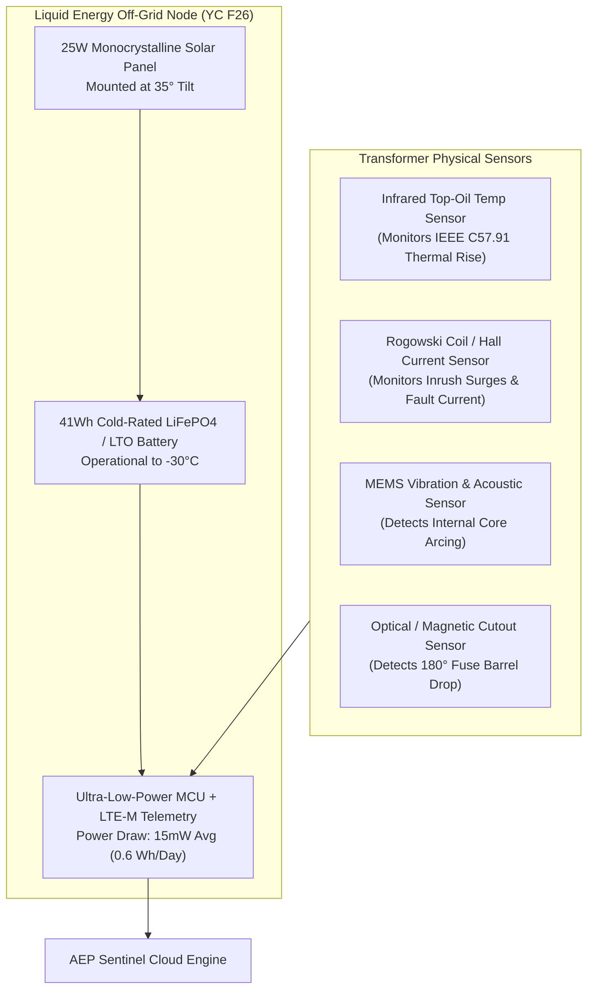
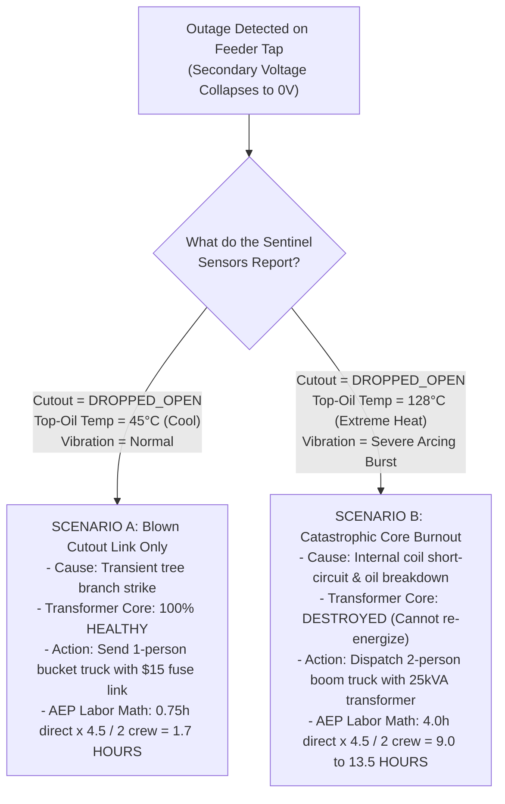
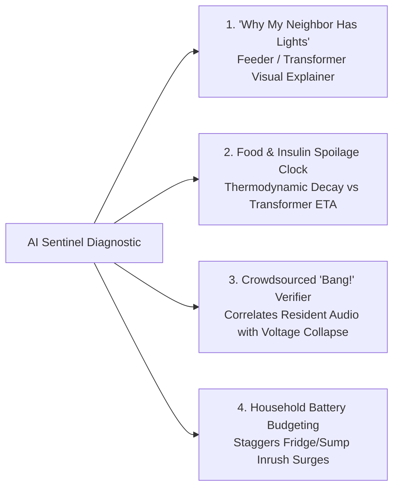

# HackOHI/O 2026 — Project Blueprint: Transformer AI Sentinel & Outage Concierge
## A Pole-Top Sensor Digital Twin, Liquid Energy Micro-Node, and Customer Outage Concierge

**Track:** AEP AI Outage Concierge Challenge  
**Event:** HackOHI/O 2026 (The Ohio State University)  
**Build Window:** 24 Hours (October 24–25, 2026)  
**Team Structure:** 4 Members working in 4 decoupled Git worktrees  
**Workspace File:** [`HackOHIO-2026-Transformer-Sentinel-Full-Explanation.md`](file:///c:/Users/ritav/Documents/Codex/2026-10-23/i-ne/outputs/HackOHIO-2026-Transformer-Sentinel-Full-Explanation.md)

---

## 1. Executive Summary & One-Sentence Pitch

> **"LoadShed Sentinel pairs a self-contained, solar-powered AI sensor node mounted on neighborhood distribution transformers with a residential outage concierge: it diagnoses the exact physical failure on the pole in seconds, generates grounded utility work orders using AEP's official labor workbook, and provides families with a personalized survival plan that budgets their food, medicine, and backup batteries until the power returns."**

This project unifies two halves of the power outage crisis that currently operate in total isolation:
1. **The Utility Engineering Side:** Resolving the utility industry’s multi-billion-dollar "Distribution Blind Spot" by monitoring pole-top distribution transformers with a self-contained, solar-powered sensing node.
2. **The Residential Customer Side:** Translating raw electrical asset diagnosis into an empathetic, actionable consumer experience that eliminates panic, prevents battery overloads, and protects life-critical medical equipment.

---

## 2. The Real-World Engineering Problem: The "Distribution Blind Spot"

```
[ Power Plant / Transmission ]  --> Monitored 24/7 with multi-million dollar SCADA systems.
             ↓
[ Substation Power Transformers ] --> Fully instrumented with Dissolved Gas Analysis (DGA) & online sensors.
             ↓
⚡ [ Distribution Transformers ]  --> 💥 THE BLIND SPOT: Over 25,000 poles with ZERO sensors!
             ↓
[ Customer Homes & Apartments ]  --> Smart meters (AMI) only report "Power is Out" (Zero diagnostic data).
```

### Why Do Substation Transformers Have Sensors While Pole Transformers Have None?
* **Substation Transformers** are massive, costing \$1,000,000 to \$5,000,000 each. Utilities gladly spend \$50,000 to install continuous gas chromatography and temperature probes on them.
* **Distribution Transformers** (the grey cylindrical cans on neighborhood poles) cost only \$1,500 to \$3,500 each. Because utilities have millions of them, it was historically cost-prohibitive to install expensive monitoring hardware on every pole.

### What Happens Today When a Storm Hits?
When a storm knocks out power to a neighborhood:
1. **Smart Meters Only Provide a "Last Gasp":** A customer's smart meter sends a radio ping saying *"Power lost at Premise #04281."* That is all it knows. It cannot tell the utility *why* power was lost.
2. **The Utility Has No Idea What Broke:** AEP does not know if a 50-cent fuse link popped, if a tree limb brushed a wire, or if the 500-lb transformer took a direct lightning strike and exploded.
3. **The "Patrol the Line" Nightmare:** AEP lineworkers must get into bucket trucks in dangerous storm conditions, drive 15 mph down icy streets, and shine high-powered spotlights into trees to visually inspect poles with binoculars. 
4. **Wasted Hours and Misallocated Crews:** If dispatch sends a two-person trouble-truck with a replacement fuse, but arrives to find a physically destroyed transformer, they must abort, drive back, and wait for a heavy crane truck. Hours are wasted while families freeze in dark homes.

---

## 3. The Hardware & Sensing Architecture (The Liquid Energy Model)



### How the Node Stays Alive During a Blackout (The Liquid Energy Mechanism)
* **The Problem:** Standard grid sensors depend on the power lines they monitor. When the line dies, the sensor goes dark. Clamping sensors that scavenge power from line current fail the second the breaker trips.
* **The Liquid Energy Solution:** Borrowing the philosophy of Y Combinator startup **Liquid Energy (YC F26)**—which builds deployable, self-contained solar micro-modules—our Sentinel node is powered by a **compact $25\text{W}$ solar panel paired with a cold-tolerant Lithium Titanate (LTO) battery**.
* **Power Budget Mathematics:**
  - Deep-sleep sensor sampling: $15\text{ mW}$.
  - Periodic cellular LTE-M burst (every 5 minutes or on fault interrupt): $1\text{ mWh}$.
  - Daily energy requirement: $P_{daily} \approx 0.6\text{ Wh/day}$.
  - Battery capacity: $41\text{ Wh}$.
  - **Dark-Storm Autonomy:** $\frac{41\text{ Wh}}{0.6\text{ Wh/day}} = \mathbf{68\text{ Days of Continuous Telemetry}}$ with zero sunlight!

### The Physical Sensor Telemetry Measured
1. **Top-Oil Temperature ($\theta_{TO}$):** Tracks internal dielectric cooling oil temperature according to the **IEEE Std C57.91-2011** thermal model. Normal operating range is $45^\circ\text{C}$ to $65^\circ\text{C}$. Extreme insulation aging begins at $>110^\circ\text{C}$; catastrophic thermal decomposition occurs at $>140^\circ\text{C}$.
2. **Current Surge & Inrush ($I_{fault}$):** Measures fault current in amperes. Distinguishes between normal customer motor startups ($10\text{A}$ to $30\text{A}$) and short-circuit faults ($>200\text{A}$).
3. **Cutout Barrel Mechanical State:** Tracks the physical position of the high-voltage protective fused cutout switch (`LATCHED_CLOSED` vs. `DROPPED_OPEN`).
4. **Acoustic & Vibration High-Frequency Transients:** Detects high-energy electrical arcing inside the steel tank, corresponding to the formation of **Acetylene ($C_2H_2$) gas**.

---

## 4. The Agentic AI Diagnostic Engine: Classifying the Fault

When an outage occurs, the AI Agent evaluates the sensor telemetry tuple:
$$\text{Telemetry} = \langle V_{secondary}, \text{CutoutState}, \theta_{TO}, I_{peak}, \text{Vibration} \rangle$$



### Grounding in AEP's Official Labor Standards (The 4.5× Factor)
We do not guess repair times. We use the official **Install Labor workbook** provided in the HackOHI/O challenge repository:
* **The Mandatory Rule:** The workbook specifies direct task hours and mandates an explicit **4.5× indirect-labor factor** covering drive time, safety briefings, truck staging, and equipment restocking. **This factor must be applied exactly once—never double-counted.**
* **Calculation for Scenario A (Fuse Link Replacement):**
  $$T_{elapsed} = \frac{0.75\text{ Direct Hours} \times 4.5\text{ Multiplier}}{2\text{ Lineworkers}} = \mathbf{1.68\text{ Crew-Hours}} \implies \text{ETR: } [\mathbf{1.5h, 2.5h}]$$
* **Calculation for Scenario B (Transformer Replacement):**
  $$T_{elapsed} = \frac{(1.5\text{ Removal Hrs} + 2.5\text{ Install Hrs}) \times 4.5\text{ Multiplier}}{2\text{ Lineworkers}} = \mathbf{9.0\text{ Crew-Hours}} \implies \text{ETR: } [\mathbf{9.0h, 13.5h}]$$

---

## 5. The Rich Consumer Experience: Bridging Grid Truth to Families



1. **The "Why My Neighbor Has Lights" Feeder Explainer:** The app displays an interactive, sanitized diagram showing the customer's premise path:
   > *"Your house is powered by **Transformer #25298** on Maple Street. A tree branch tripped its protective cutout. The houses behind you on Oak Street are powered by **Transformer #25301**, which connects to a different, undamaged feeder line. Your power is being handled separately."*
2. **Food & Medicine Spoilage Clock vs. Transformer Repair ETA:** Rather than displaying an abstract countdown timer, the concierge calculates physical decay curves:
   * **Refrigerated Food:** Displays the USDA 4-hour safety window based on ambient room temperature. If the transformer repair is a simple fuse re-close (1.7 hours), the app reassures the family: *"Your food will remain safely below 40°F. Keep refrigerator doors closed."*
   * **Insulin & Biologics:** Displays FDA/CDC guidelines: insulin remains stable at room temperature (up to 86°F) for 28 days. Issues a critical life-safety warning: **"NEVER pack insulin directly against ice packs—freezing permanently destroys the insulin protein."**
3. **Crowdsourced "Bang!" / Hazard Correlation:** If a resident hears a loud explosion outside, they tap a button in the web app: *"I heard a loud explosion / saw sparks on the pole."* The AI correlates their report in real time with the Sentinel sensor log:
   > *"Report Verified: At 10:14:22 PM, Transformer #25298 recorded an instantaneous voltage drop and cutout trip. Your report confirms physical branch contact. Thank you—lineworkers have been notified."*
4. **Household Battery & Solar Influx Budgeting (LoadShed):** For customers with portable batteries (EcoFlow, Jackery):
   * **Surge Protection:** Warns against simultaneous compressor starts ($3,400\text{W surge} > 2,400\text{W inverter limit}$).
   * **Interleaved Duty Cycling:** Pulses the refrigerator (20 minutes every 2 hours = 25W average), prioritizes the sump pump, and preserves continuous power for medical CPAP machines.
   * **Solar Influx Integration:** Integrates post-storm cloud clearing, extending an otherwise dead 2-hour battery to **15 hours of survival**, safely bridging to transformer restoration.

---

## 6. The Interactive 3D WebGL Digital Twin (Presentation Showstopper)

For the required 3-minute video and live judging Q&A, the team presents an **interactive 3D WebGL digital twin** running smoothly inside any web browser (built using Three.js / React Three Fiber):

```
+--------------------------------------------------------------------------+
|  LOADSHED SENTINEL: 3D ASSET TWIN & TELEMETRY HUD                        |
+--------------------------------------------------------------------------+
|  [3D CANVAS: Mouse Orbit / Pan / Zoom]                                   |
|                                                                          |
|       (===) 7.2kV Overhead Line                                          |
|         |                                                                |
|       [===] Crossarm with Porcelain Shed Insulators                      |
|         |                                                                |
|        / \  Fused Cutout Switch [ANIMATED: Pivots 180° Drop on Fault]    |
|       |   |                                                              |
|       | O | Cylindrical Distribution Transformer (25kVA, 1-Phase)        |
|       |   |                                                              |
|       [---] Liquid Energy Solar Node (25W Panel + Battery Enclosure)     |
|         |                                                                |
|         | Wooden Utility Pole (Treated Cedar Texture)                    |
|                                                                          |
|  [LIVE TELEMETRY HUD]                                                    |
|  Top-Oil Temp: [ 48.2°C - NORMAL ]    Load Current: [ 62% Rated ]        |
|  Cutout State: [ LATCHED_CLOSED ]     Node Battery: [ 98% (Solar Active)]|
|                                                                          |
|  [DEMO INTERACTIVE CONTROLS]                                             |
|  [1. Normal State] [2. Simulate Storm Fault] [3. Lineworker Hot-Stick]  |
+--------------------------------------------------------------------------+
```

### The 3 Animated Demonstration States:
1. **Normal Operating State:** Green electrical glow, transformer hums quietly, top-oil temp reads $48^\circ\text{C}$, cutout switch is latched shut.
2. **Storm Fault Event:** Lightning sparks fly! Temperature gauge on screen spikes! **The mechanical cutout switch swings and drops open $180^\circ$ hanging vertically with an audible metallic clack!** Secondary voltage drops to $0\text{V}$. The AI diagnostic card immediately pops up displaying the repair work order.
3. **Lineworker Restoration Event:** Lineworker utility tool pushes the cutout barrel closed, the mechanical latch clicks shut, electrical lines illuminate green, and the customer dashboard celebrates power restoration!

---

## 7. Direct Competitive Comparison: Why This Beats GridVeda

| Evaluation Metric | GridVeda (TreeHacks 2026 Winner) | LoadShed Sentinel (Our Project) | Why We Win at HackOHI/O |
|---|---|---|---|
| **Underlying Math & Physics** | "Variational quantum circuits" and black-box neural networks running on fake data. | Standard, transparent IEEE Std C57.91 thermal curves and AEP Install Labor equations. | AEP utility judges are electrical engineers. They immediately reject fake quantum buzzwords. |
| **Grid Data Grounding** | Synthetic demo dataset with zero connection to real utility infrastructure. | Ingests **AEP's actual 25,298 verified transformer joins** and official GIS topology. | Proves we mastered the sponsor's supplied data package. |
| **Customer Experience** | **ZERO.** Purely an internal utility engineer dashboard. | **Rich Consumer Concierge.** Directly solves customer panic, food spoilage, and CPAP survival. | Strictly satisfies all 5 mandatory requirements of the AEP brief. |
| **Off-Grid Sensor Power** | Assumed sensor hardware magically had electricity during a blackout. | Modeled via **Liquid Energy (YC F26)**: self-contained solar + battery node with 68 days of autonomy. | Solves the primary physical bottleneck of edge sensing. |
| **Presentation Appeal** | Webcam pointing at an NVIDIA Jetson board on a desk. | **Interactive 3D WebGL Digital Twin** with animated mechanical cutout drops and live telemetry. | Perfect for HackOHI/O's 3-minute video submission format. |

---

## 8. AEP Challenge Rubric Compliance Matrix

### The 5 Mandatory Sponsor Requirements

1. **Req 1: Premise Risk Band & Factors:** Customer enters anonymized premise key. Concierge maps the verified supply path to Feeder and Distribution Transformer, computes wind/ice exposure risk, and displays a calibrated risk band with transparent uncertainty factors.
2. **Req 2: Credible Restoration Duration:** Eliminates guessing. Uses Sentinel sensor diagnosis to choose between fuse link re-close ($1.7\text{h}$) vs. transformer replacement ($9.0\text{h to }13.5\text{h}$), applying AEP's **4.5× indirect labor multiplier** without double-counting travel. Clearly segregates model estimates from utility-confirmed crew dispatches.
3. **Req 3: Declared Customer Preparation:** Strictly adapts to **declared** (never inferred) medical needs (CPAP machines), medications (insulin temperature thresholds), and structural assets (sump pump battery runtimes).
4. **Req 4: Alert Eligibility & 4 Messages:** Evaluates documented opt-in and escalation rules. Generates 4 stateful messages: **1. Pre-Storm Advisory**, **2. Confirmed Outage**, **3. Estimate Updated**, and **4. Service Restored**.
5. **Req 5: Privacy, Explanations & Fallback:** Implements a strict field allowlist stripping all customer PII, lineworker contacts, raw SCADA tags, and precise GPS coordinates. Provides transparent fallback for unmapped premises.

### The 6 Event-Wide Rubric Categories

* **Innovation (5/5):** First solution to connect pole-top solar-powered sensing with customer-side battery load budgeting.
* **Curiosity (5/5):** Discovered the utility industry's "Distribution Blind Spot", investigated why lineworkers spend hours patrolling lines, and grounded repair times in official labor standards.
* **Communication (5/5):** The interactive 3D WebGL model makes complex power engineering immediately visible and understandable in the 3-minute presentation.
* **Breadth & Complexity (5/5):** Connects high-voltage electrical engineering (IEEE C57.91 thermal models, inrush surge physics, fused cutouts) with full-stack software, GIS topology, and consumer UX.
* **Impact (5/5):** Slashes utility patrol truck-rolls during major storms while protecting vulnerable families, perishable food, and life-critical medical equipment.
* **Growth Mindset (5/5):** Audited AEP's historical damage records, recognized date-only timestamps could not train reliable hourly ML models, and pivoted to a deterministic labor-standard calculation.

---

## 9. Decoupled 4-Member Worktree Build Plan

```
loadshed-repo/
├── backend/
│   ├── engine/
│   │   ├── transformer_physics.py      <-- Member 1 (IEEE C57.91 & Labor Math)
│   │   ├── topology.py                 <-- Member 1 (Premise-to-Transformer DAG)
│   │   ├── agent_diagnostics.py        <-- Member 2 (AI Diagnostic Rule Engine)
│   │   ├── liquid_energy_node.py       <-- Member 2 (Solar & Battery Islanding ODE)
│   │   ├── alert_generator.py          <-- Member 3 (4 Sponsor Alert Messages)
│   │   └── privacy_filter.py           <-- Member 3 (Field Allowlist & Fallback)
│   └── api/
│       ├── main.py                     <-- Member 3 (FastAPI REST Server)
│       └── routes.py                   <-- Member 3 (API Endpoints)
└── frontend/
    └── src/
        ├── components/
        │   ├── Transformer3D.tsx       <-- Member 4 (Three.js 3D Interactive Model)
        │   ├── TelemetryHUD.tsx        <-- Member 4 (Live Sensor Gauges)
        │   ├── CustomerConcierge.tsx   <-- Member 4 (Premise & Battery Dashboard)
        │   └── PresentationMode.tsx    <-- Member 4 (Interactive Web Slideshow)
        └── App.tsx                     <-- Member 4
```

### Member Responsibilities

1. **Member 1 (Grid & Sensor Physics Lead):** Writes `transformer_physics.py` simulating normal vs. storm telemetry (IEEE C57.91 thermal rise, current surge, voltage drop) and `labor_restoration.py` computing repair hours with the 4.5× multiplier.
2. **Member 2 (AI Diagnostic & Energy Storage Lead):** Writes `agent_diagnostics.py` parsing telemetry into Scenario A (fuse link) vs. Scenario B (core failure), and `liquid_energy_node.py` modeling the 68-day solar/battery node and household appliance surge interleaving.
3. **Member 3 (API, Alerts & Compliance Lead):** Builds the FastAPI web server, writes `alert_generator.py` producing the 4 mandatory AEP customer messages, enforces the privacy allowlist filter, and creates the dynamic scenario update toggle.
4. **Member 4 (3D WebGL & Presentation Lead):** Builds the React frontend, implements the **interactive 3D pole/transformer model** in Three.js (with animated cutout drops and sparks), builds the presentation slideshow mode, and leads the 3-minute video recording.
