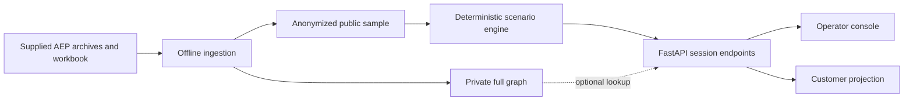

# Architecture

The system separates source ingestion, scenario calculation, HTTP state, and presentation. It does not depend on a live utility connection or an external language-model service at runtime.

## Source processing

`pipeline/` reads the supplied ZIP, DBF, shapefile, text-path, and workbook inputs. Equipment dependencies come from supplied ordered paths and validated joins. Geographic line layers do not create inferred electrical connections. The public sample contains 16 premise paths, 12 equipment nodes, and 27 ordered relationships.

`engine/aep_impact.py` validates the public bundle and builds a reverse index from each equipment token to its dependent sample premises. `engine/topology.py` supports the optional private full graph. Public exports use anonymous tokens and generalized equipment geometry.

## Calculation

`engine/scenarios.py` creates one canonical snapshot for the selected scenario and asset. Diagnosis evaluates evidence provenance, timestamps, binding, and contradictions. Crew logic returns capabilities for human review. Restoration logic schedules declared work against exclusive crew resources and prerequisites. Customer logic derives a restricted view, preparation guidance, battery arithmetic, and notification previews.

All these calculations are deterministic for supplied inputs. Relative evidence scores are not calibrated probabilities. A scenario field-confirmation event remains a scenario assumption.

## API state

`api/main.py` stores demonstration sessions in process memory, keyed by `X-Session-ID`. Mutation locks and expected revisions protect updates within the implemented session flow. Rejected candidate updates do not commit partial authorization or task completion.

The cache is not persistent storage, authenticated tenancy, or a cross-worker consistency mechanism. See [operating notes](operations.md).

## Frontend state

The React `IncidentProvider` owns the selected incident, catalog, and active asset. A shared generation counter rejects superseded scenario, asset, and reset responses. Customer requests separately reject responses belonging to older household inputs or incident revisions.

TypeScript interfaces in `contracts/` align the snapshot with backend schemas. UI components display canonical calculation results rather than inventing local restoration estimates. Three.js scenes are loaded lazily; equipment diagrams remain available when graphics are unsupported or fail.

## API reference

Run the backend and open `/docs` for the generated OpenAPI documentation. Main endpoint groups are `/api/scenario/*`, `/api/customer/*`, `/api/aep/*`, and `/api/topology/*`; `/api/health` reports application health. Caller-supplied session IDs are demonstration state keys, not authentication credentials.
